# ST-G05-01 — R02 Execution Report

| Item | Recorded value |
|---|---|
| Date and time | 17 November 2026, approximately 17:19–17:25 Asia/Bangkok |
| Staff session | In-app browser, Group 5 account `itcs386-g05` |
| Customer session | Separate Safari guest session |
| Product | `G05 Mug R02`, ID `687` |
| Coupon | `G05SAVE10-R02`, ID `688`, 10%, restricted to product 687 |
| Invalid coupon | `G05BAD-R02` |
| Customer email | `g05.mug.r02@example.com` |
| Order | `692`, Cash on delivery, total 360.00 THB |
| Final status | Completed, verified after reload |
| Result | **9 of 9 steps passed** for the revised product-list scenario |

## Step results

| Step | Actual result | Result | Evidence filenames |
|---|---|---|---|
| 1 | Published product 687 (G05 Mug R02), simple product, regular price 200.00 THB, stock 20, stock tracking enabled and backorders disabled. Saved settings verified. | Pass | [S01-price.jpg](screenshots/ST-G05-01/R02/S01-price.jpg); [S01-stock.jpg](screenshots/ST-G05-01/R02/S01-stock.jpg) |
| 2 | Published coupon 688 (G05SAVE10-R02), percentage 10, minimum spend 0, restricted to product 687. Saved restriction verified. | Pass | [S02-discount.jpg](screenshots/ST-G05-01/R02/S02-discount.jpg); [S02-restriction.jpg](screenshots/ST-G05-01/R02/S02-restriction.jpg) |
| 3 | Opened Shop page 1, followed Next Page through page 12, located G05 Mug R02 in the list and clicked its name. Product details showed 200.00 THB and stock 20. No storefront search or direct product URL was used. | Pass | [S03-shop-start.png](screenshots/ST-G05-01/R02/S03-shop-start.png); [S03-found-in-list.png](screenshots/ST-G05-01/R02/S03-found-in-list.png); [S03-product.png](screenshots/ST-G05-01/R02/S03-product.png) |
| 4 | Guest cart contained product 687, quantity 2, unit price 200.00 THB and subtotal 400.00 THB. | Pass | [S04-cart.png](screenshots/ST-G05-01/R02/S04-cart.png) |
| 5 | G05BAD-R02 was rejected as nonexistent; total remained 400.00 THB. G05SAVE10-R02 applied one 40.00 THB discount; total became 360.00 THB. | Pass | [S05-invalid.png](screenshots/ST-G05-01/R02/S05-invalid.png); [S05-valid.png](screenshots/ST-G05-01/R02/S05-valid.png) |
| 6 | Opened checkout and returned through Cart without ordering. Quantity 2, coupon and total 360.00 THB persisted. | Pass | [S06-checkout.png](screenshots/ST-G05-01/R02/S06-checkout.png); [S06-returned-cart.png](screenshots/ST-G05-01/R02/S06-returned-cart.png) |
| 7 | Updated guest email to g05.mug.r02@example.com and expanded the retained billing address to verify all values. Placed one COD order, 692. Confirmation showed subtotal 400.00 THB, discount 40.00 THB and total 360.00 THB, without separate shipping/tax charges. | Pass | [S07-checkout-input.png](screenshots/ST-G05-01/R02/S07-checkout-input.png); [S07-confirmation.png](screenshots/ST-G05-01/R02/S07-confirmation.png) |
| 8 | Staff search for 692 located the matching guest order. Product, quantity, coupon, email and totals matched the confirmation. Order notes recorded stock reduction from 20 to 18. | Pass | [S08-staff-order.jpg](screenshots/ST-G05-01/R02/S08-staff-order.jpg) |
| 9 | Changed order 692 from Processing to Completed, saved and reloaded. Completed persisted and total remained 360.00 THB. | Pass | [S09-completed.jpg](screenshots/ST-G05-01/R02/S09-completed.jpg) |

## R02 screenshot evidence

### Step 1 — Pass

**Published mug and regular price**

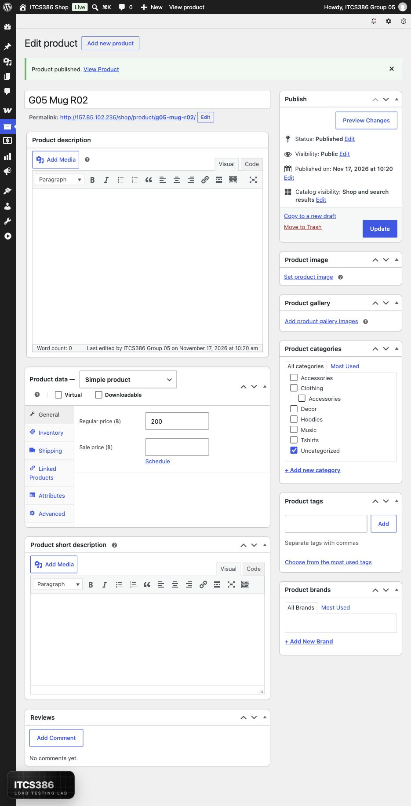

**Saved stock quantity and backorder settings**

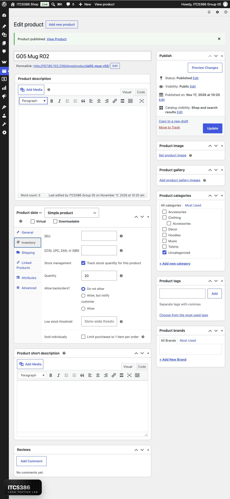

### Step 2 — Pass

**Published 10% coupon**

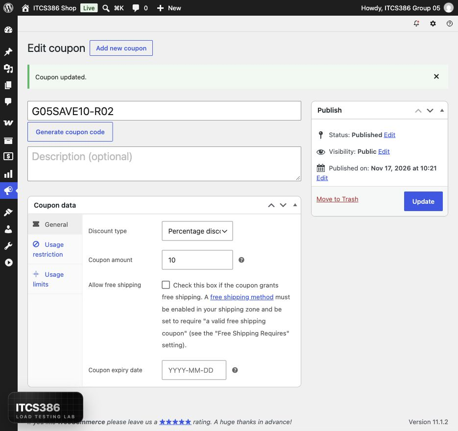

**Coupon restricted to G05 Mug R02**

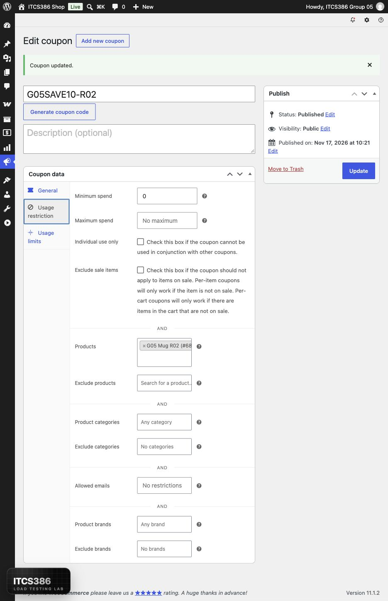

### Step 3 — Pass

**Shop list at the start of product discovery**

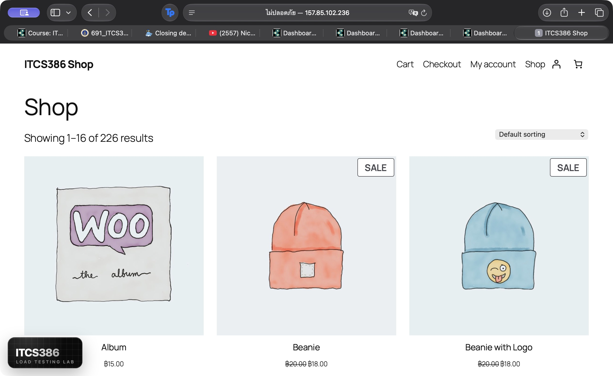

**G05 Mug R02 found in the Shop list on page 12**

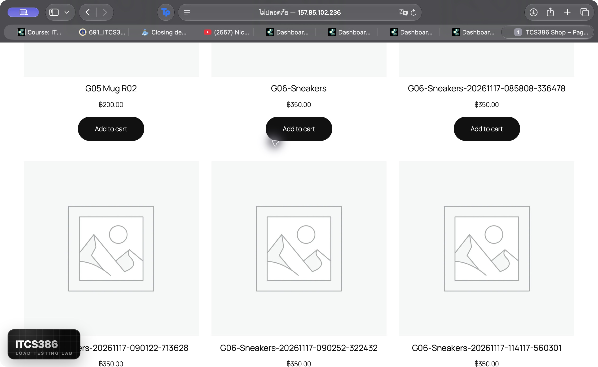

**Product details opened from the list**

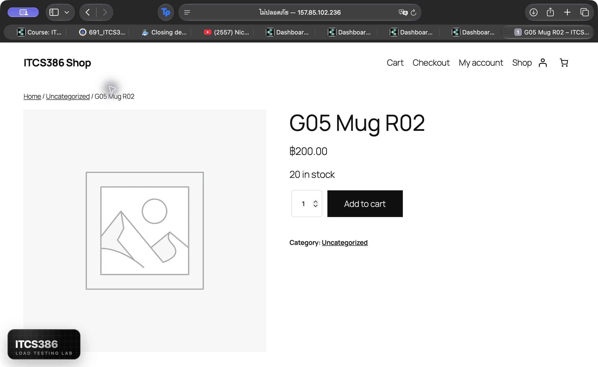

### Step 4 — Pass

**Two mugs and 400 THB subtotal**

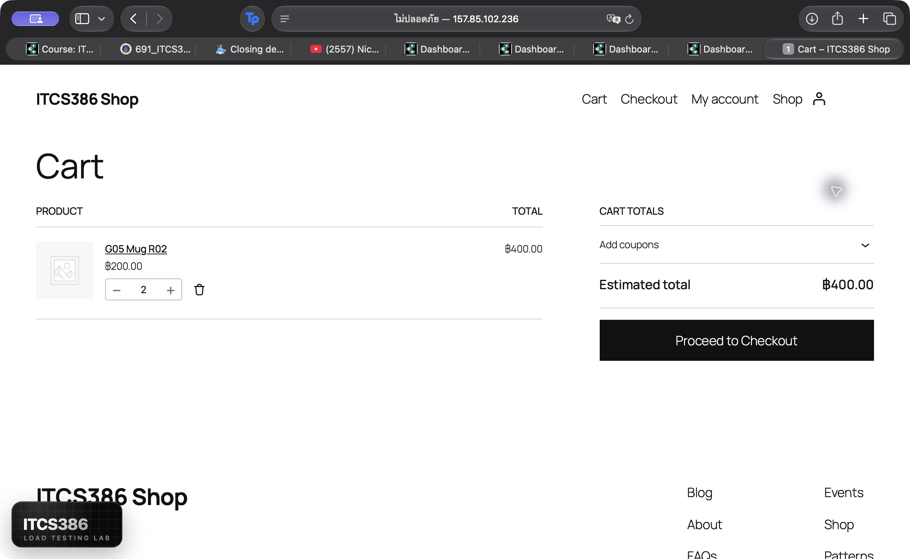

### Step 5 — Pass

**Nonexistent coupon rejected**

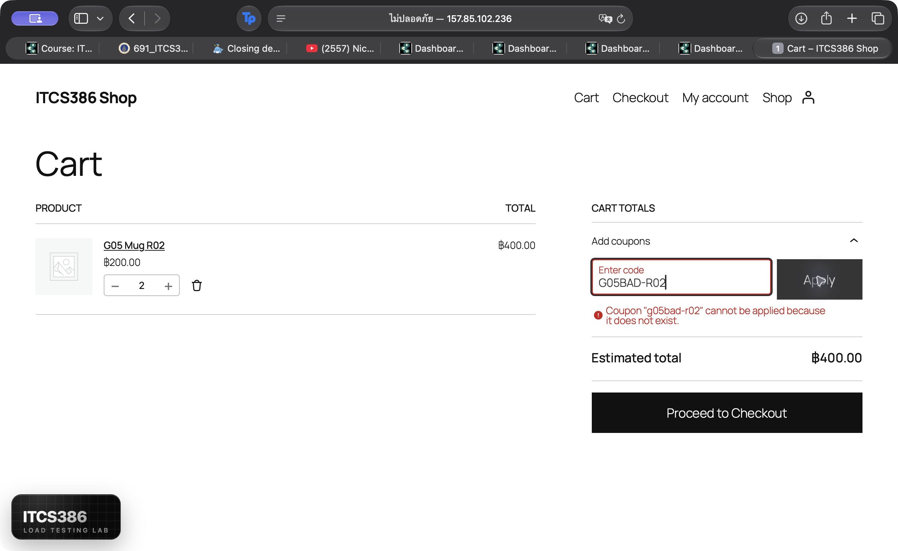

**Valid coupon applied; total 360 THB**

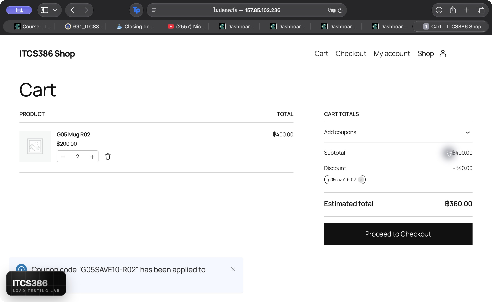

### Step 6 — Pass

**Checkout opened before returning**

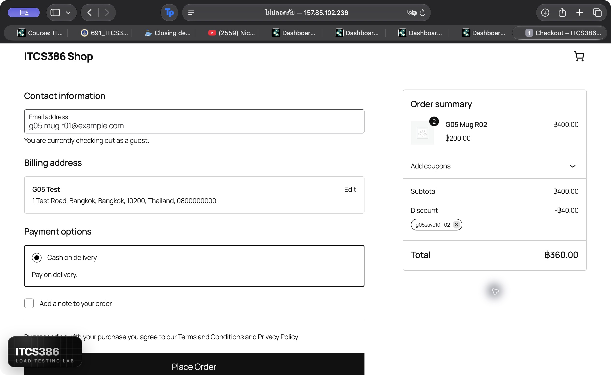

**Returned cart retains quantity and discount**

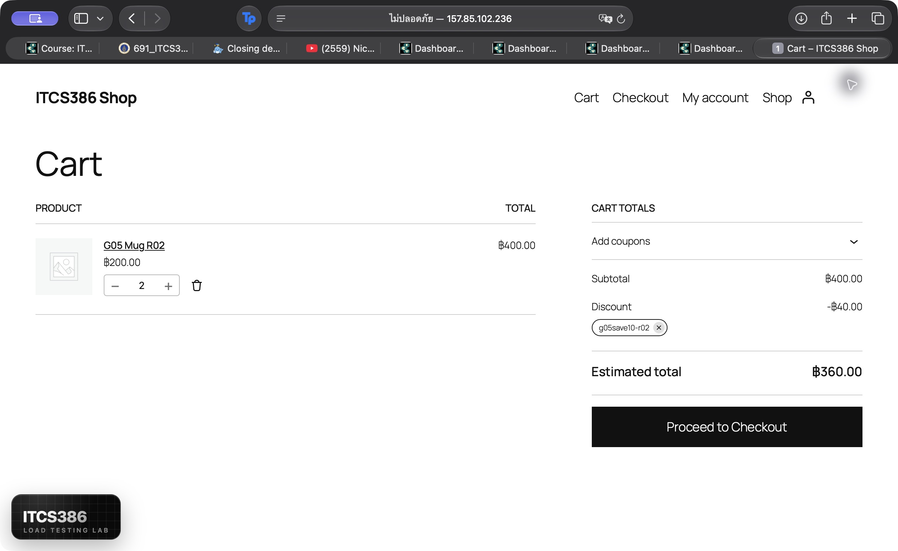

### Step 7 — Pass

**Guest checkout inputs**

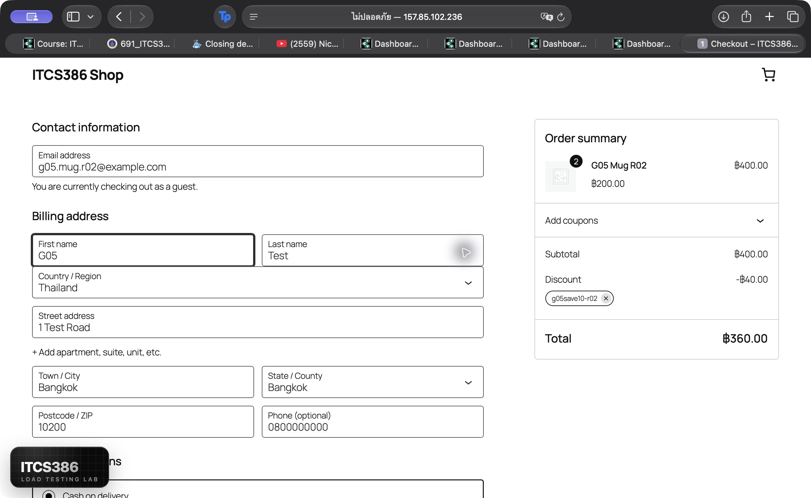

**Order 692 confirmation**

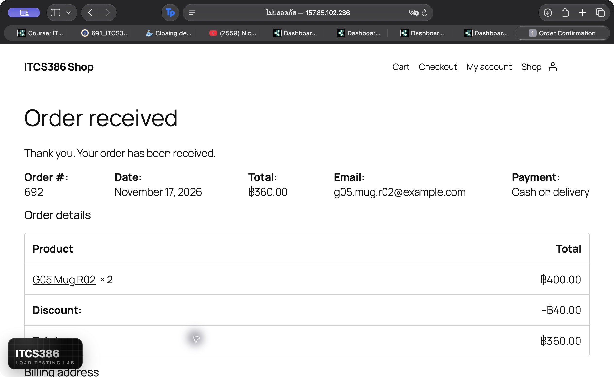

### Step 8 — Pass

**Staff order details match the customer confirmation**

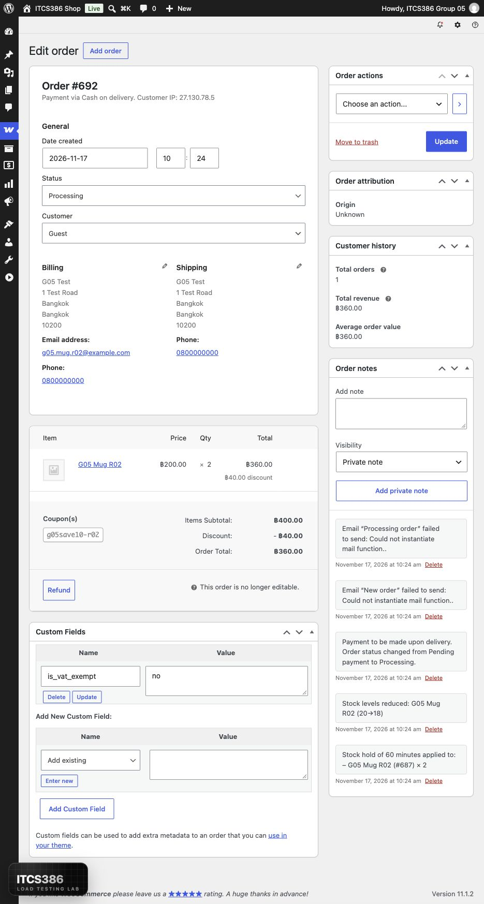

### Step 9 — Pass

**Completed status persists after reloading**

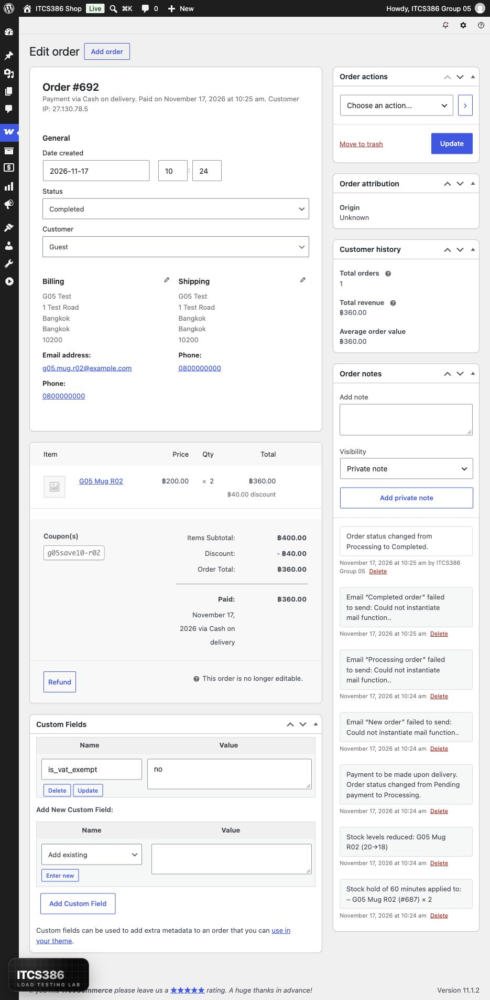

## Checkout inputs

| Field / control | Actual value |
|---|---|
| Checkout mode | Guest |
| Email address | g05.mug.r02@example.com |
| First name / Last name | G05 / Test |
| Country / Region | Thailand |
| Street address | 1 Test Road |
| Apartment/unit | Empty; optional control left closed |
| Town / City | Bangkok |
| State / County | Bangkok |
| Postcode / ZIP | 10200 |
| Phone | 0800000000 |
| Billing details | Retained from the previous guest session; expanded and verified. Email changed to R02. |
| Separate shipping form / method selector | Not displayed; no separate input made. Staff order showed shipping address matching billing. |
| Payment | Cash on delivery |
| Add a note to your order | Unchecked |
| Submission | Place Order clicked once |
| Totals | 400.00 THB subtotal − 40.00 THB discount = 360.00 THB |

## Observations

- Product discovery passed through the visible Shop list on page 12.
- New order, Processing order and Completed order email notifications failed with “Could not instantiate mail function”. Email delivery was outside the case assertions; these failures did not prevent checkout or order completion.
- Product 687, coupon 688 and order 692 remain on the lab server.
- No API endpoint coverage is inferred from these UI results.
- All 16 R02 screenshots are stored in `screenshots/ST-G05-01/R02/` and embedded by step below.
- Captures may contain browser tab titles or requester IP information; review before wider sharing. Native captures may show the Computer Use pointer overlay rather than a normal macOS cursor.

## Related documents

- [System test cases](system-test-cases.md)
- [Traceability matrix](api-traceability-matrix.md)
