# ST-G05-02 — R01 Execution Report

| Item | Recorded value |
|---|---|
| Date/time | 17 November 2026, 20:56–21:04 Asia/Bangkok |
| Staff | In-app browser, `itcs386-g05` |
| Customer | Separate Safari guest session; initially empty cart |
| Product | `G05 Cap R01`, ID `773`, 150 THB |
| Initial / final stock | 3 / 1 |
| Order | `774`, COD, 300 THB, Processing |
| Customer email | `g05.cap.r01@example.com` |
| Result | **9/9 Pass** against the existing behavioral expected results |
| Screenshots | 18 images, embedded below |

## UI alignment

The inputs are the controls actually used, not inferred API fields. The admin stock field is **Quantity** under **Stock management**. The cart field is exposed as **Quantity of G05 Cap R01 in your cart.**; leaving it with Tab applies the change without an Update cart button. At stock 1 the product quantity field disappears, so step 9 attempts two units using two Add to cart clicks. These are documented interaction refinements; expected results were not changed to match the outcome.

## Step results

| Step | Action | Input data actually used | Expected result | Actual result | Pass or fail |
|---|---|---|---|---|---|
| 1 | Staff creates and publishes the product, then reopens General and Inventory to verify the saved values. | Product name = G05 Cap R01; Product data = Simple product; Regular price (฿) = 150; Sale price (฿) = blank; Stock management = checked; Quantity = 3; Allow backorders? = Do not allow; Sold individually = unchecked; click Publish. Virtual and Downloadable remain unchecked. | Product is published at 150 THB with stock 3 and no backorders. | Created product 773. Saved simple-product price is 150 THB; Stock management checked, Quantity 3, Do not allow selected and Sold individually unchecked. | Pass |
| 2 | Customer opens Shop, follows Next Page until G05 Cap R01 is visible, clicks its name, leaves Product quantity at 1 and clicks Add to cart, then View cart. | Start = http://157.85.102.236/shop/; product-list target = G05 Cap R01; Next Page through page 13 in this run; Product quantity = 1; Add to cart; View cart. No search field or direct product URL. | Correct product appears at 150 THB; cart contains one unit with merchandise subtotal 150 THB. | Found G05 Cap R01 in the Shop list on page 13 (249 catalog results), opened it and observed 150 THB / 3 in stock. Added one unit; cart subtotal was 150 THB. | Pass |
| 3 | Customer selects the cart quantity value, enters 4 and presses Tab to leave the field. | Field accessibility label = Quantity of G05 Cap R01 in your cart.; replace 1 with attempted value 4; press Tab. Available stock before this attempt = 3. | The excessive quantity is prevented or rejected with visible feedback; cart does not retain more than stock 3. | After attempted input 4 and Tab, the quantity was capped at 3, Increase quantity was disabled and the total became 450 THB. No error banner appeared; the control/value change was the visible feedback. | Pass |
| 4 | Customer selects the cart quantity value, enters 2 and presses Tab. | Field = Quantity of G05 Cap R01 in your cart.; enter 2; press Tab. No separate Update cart button was used. | Cart updates to two units and merchandise subtotal 300 THB. | Quantity updated to 2 and the cart total became 300 THB. | Pass |
| 5 | Customer clicks the trash/remove control for G05 Cap R01. | Trash icon; accessibility label = Remove G05 Cap R01 from cart. | Cart becomes empty with no remaining merchandise charge for the product. | The page displayed Your cart is currently empty! and the test product was removed. | Pass |
| 6 | Customer uses browser Back to return to the product, sets Product quantity to 2, clicks Add to cart and then View cart. | Product quantity = 2 on G05 Cap R01; click Add to cart, then View cart. | Cart contains exactly two units with merchandise subtotal 300 THB and no duplicate line. | Re-added exactly two units; one cart line showed quantity 2 and total 300 THB, with no duplicate line or retained coupon. | Pass |
| 7 | Customer clicks Proceed to Checkout, changes the Email address, expands Edit billing address to verify the retained fields, and clicks Place Order once. | Email address = g05.cap.r01@example.com; click Edit billing address; First name = G05; Last name = Test; Country / Region = Thailand; Street address = 1 Test Road; Town / City = Bangkok; State / County = Bangkok; Postcode / ZIP = 10200; Phone (optional) = 0800000000. Verify retained billing values; leave + Add apartment, suite, unit, etc. closed; Cash on delivery selected; Add a note to your order unchecked; click Place Order once. No separate shipping-address checkbox or shipping-method selector was displayed. | Confirmation shows an order number, two units and merchandise total 300 THB; grand total matches displayed shipping/tax. | Created order 774 as a guest using Cash on delivery. Confirmation showed G05 Cap R01 × 2, email g05.cap.r01@example.com and total 300 THB. No separate shipping/tax charge appeared. | Pass |
| 8 | Staff searches Orders for the captured order number, opens the order, then opens the product and its Inventory tab. | Search orders: = 774; open #774 G05 Test; product = G05 Cap R01 (ID 773); open Inventory and read Quantity. Order/product IDs were captured during execution, not supplied when creating records. | Order quantity is two and remaining stock is one. Earlier cart changes did not cause extra permanent stock deductions. | Order 774 matched the customer confirmation and had status Processing. Order notes recorded stock 3→1; the saved product Inventory Quantity was 1. Earlier cart changes caused no extra permanent stock deduction. | Pass |
| 9 | Customer confirms the post-purchase cart is empty, reopens the product through the Shop list and attempts a total of two units by clicking Add to cart twice. Open View cart after the rejection. | Start with empty cart; product page shows 1 in stock and no Product quantity field. Click Add to cart once to add 1, then click it again to attempt a total of 2; click View cart. Do not enter 2 into a nonexistent field. | The system prevents adding more than the one unit remaining. | With one unit remaining, the product page exposed only Add to cart, not a quantity field. First click added one. Second click was rejected: You cannot add that amount to the cart — we have 1 in stock and you already have 1 in your cart. Cart retained quantity 1, total 150 THB and a disabled Increase quantity control. | Pass |

### Test 2 checkout — observed fields and values

| UI label / control | Value or action in this run |
|---|---|
| Checkout mode | Guest |
| Email address | Replaced the retained email with `g05.cap.r01@example.com` |
| Edit billing address | Expanded to inspect the retained address |
| First name | `G05` |
| Last name | `Test` |
| Country / Region | `Thailand` |
| Street address | `1 Test Road` |
| + Add apartment, suite, unit, etc. | Left closed; second address line empty |
| Town / City | `Bangkok` |
| State / County | `Bangkok` |
| Postcode / ZIP | `10200` |
| Phone (optional) | `0800000000` |
| Cash on delivery | Selected |
| Add a note to your order | Unchecked; note empty |
| Separate shipping form / same-as-billing checkbox | Not displayed; no such checkbox was clicked |
| Shipping method | No selector displayed; no manual shipping-method input |
| Place Order | Clicked once |
| Product / quantity | `G05 Cap R01` / `2` |
| Subtotal / total | `300.00 THB` / `300.00 THB`; no coupon or separate shipping/tax charge displayed |

The billing values were retained by the guest session and verified after expanding the form; they were not all typed again. The staff order displayed shipping details matching billing. This is an observed result, not evidence of a same-as-billing input control.

### Test 2 observations and cleanup

- Step 3 passed through visible quantity limiting (4 was capped at 3), not an error message.
- Step 9 passed through rejection of the second Add to cart request; the quantity field was absent at stock 1.
- New order and Processing order email notifications failed with “Could not instantiate mail function”. Email delivery was not an assertion of this case.
- After step 9 evidence was captured, the one unpurchased cap was removed and the cart was verified empty. No second order was placed.
- Product 773 remains with stock 1. Order 774 remains Processing; changing it to Completed is not part of Test 2.
- All screenshots are unaltered. Browser chrome and staff requester IP may be visible. No password is included.

### Test 2 — screenshots by step

#### Step 1 — Pass

Created product 773. Saved simple-product price is 150 THB; Stock management checked, Quantity 3, Do not allow selected and Sold individually unchecked.

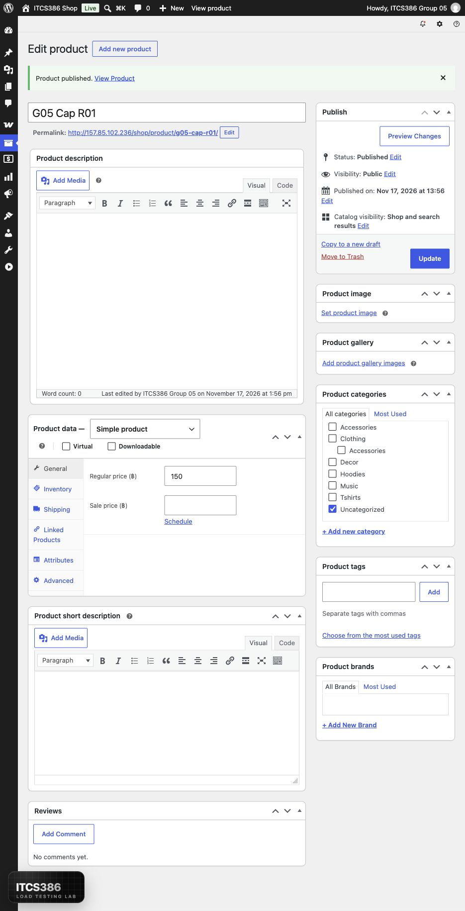

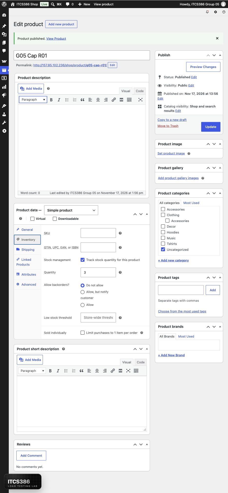

#### Step 2 — Pass

Found G05 Cap R01 in the Shop list on page 13 (249 catalog results), opened it and observed 150 THB / 3 in stock. Added one unit; cart subtotal was 150 THB.

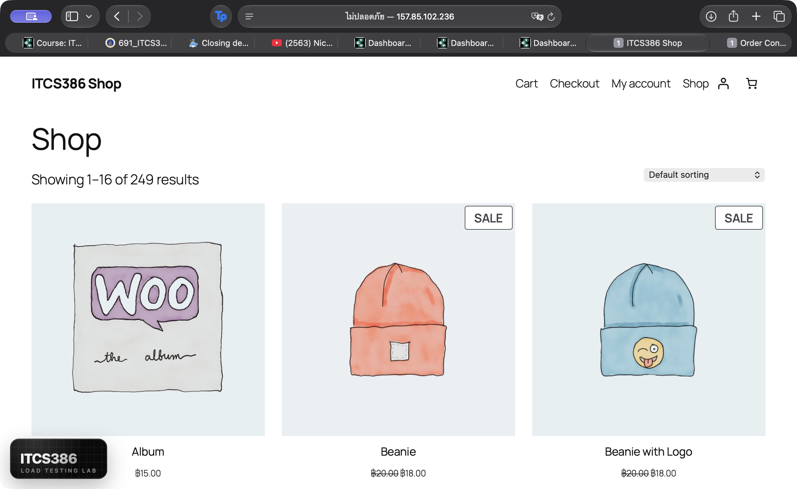

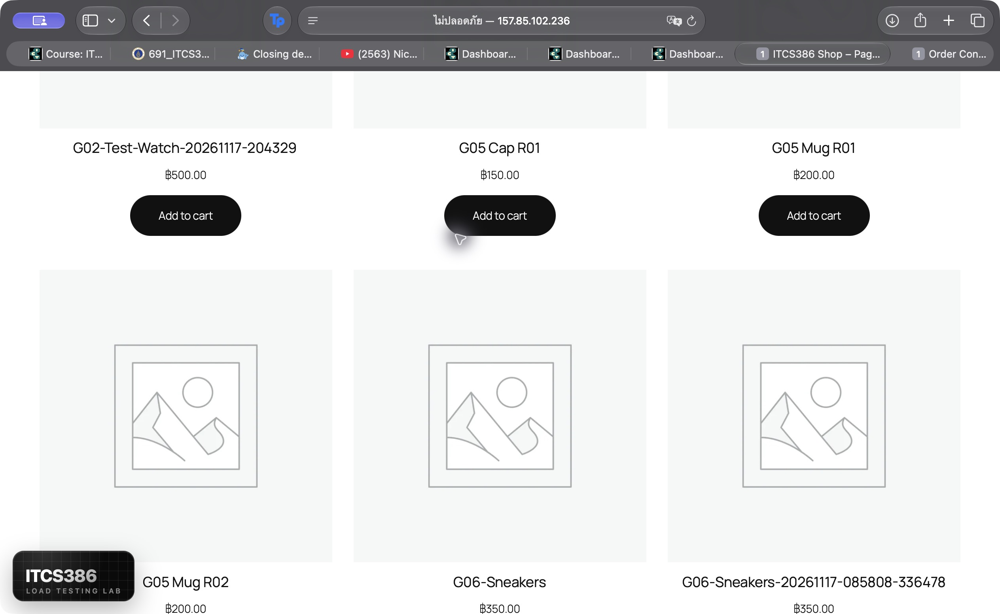

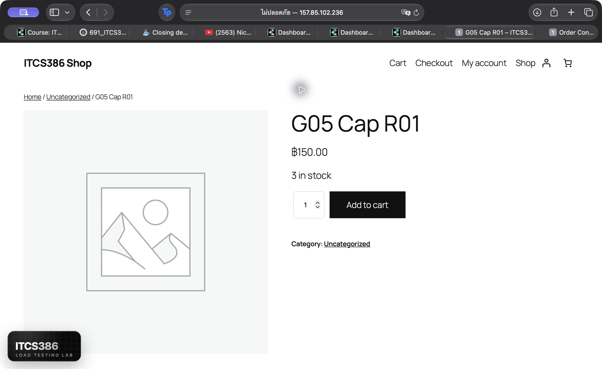

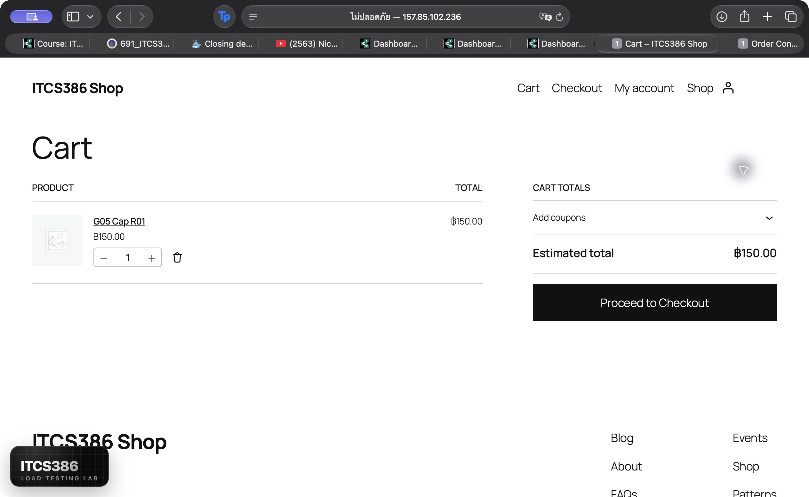

#### Step 3 — Pass

After attempted input 4 and Tab, the quantity was capped at 3, Increase quantity was disabled and the total became 450 THB. No error banner appeared; the control/value change was the visible feedback.

#### Step 4 — Pass

Quantity updated to 2 and the cart total became 300 THB.

#### Step 5 — Pass

The page displayed Your cart is currently empty! and the test product was removed.

#### Step 6 — Pass

Re-added exactly two units; one cart line showed quantity 2 and total 300 THB, with no duplicate line or retained coupon.

#### Step 7 — Pass

Created order 774 as a guest using Cash on delivery. Confirmation showed G05 Cap R01 × 2, email g05.cap.r01@example.com and total 300 THB. No separate shipping/tax charge appeared.

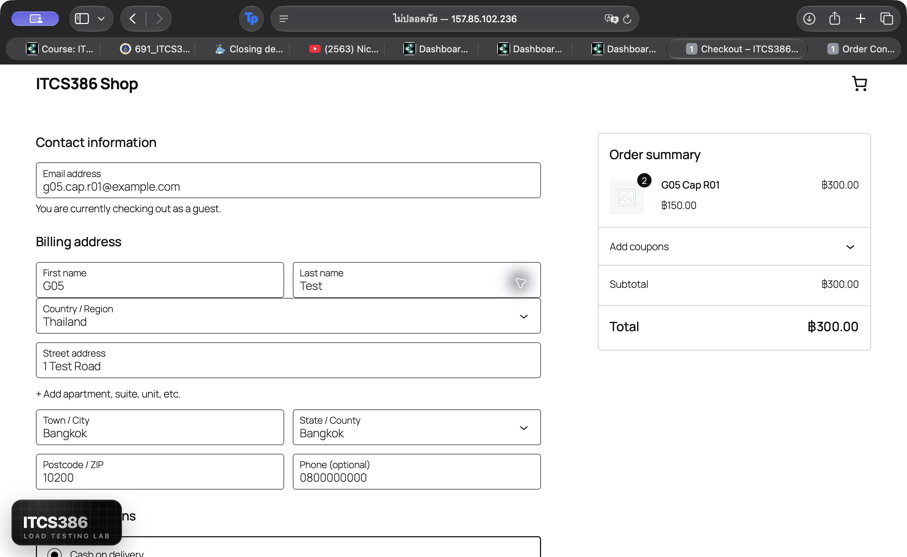

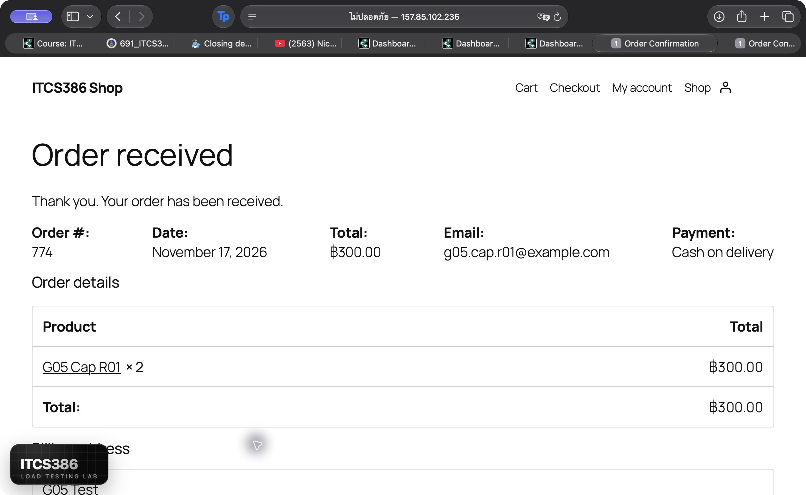

#### Step 8 — Pass

Order 774 matched the customer confirmation and had status Processing. Order notes recorded stock 3→1; the saved product Inventory Quantity was 1. Earlier cart changes caused no extra permanent stock deduction.

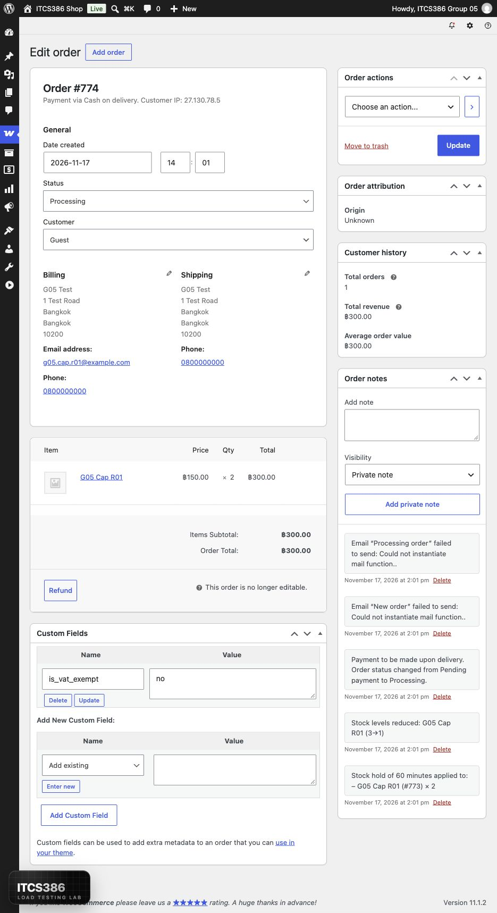

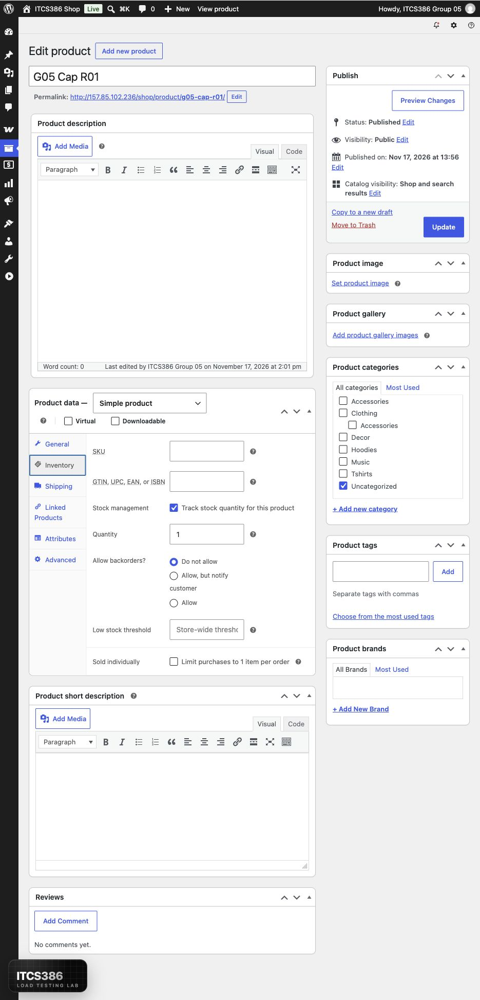

#### Step 9 — Pass

With one unit remaining, the product page exposed only Add to cart, not a quantity field. First click added one. Second click was rejected: You cannot add that amount to the cart — we have 1 in stock and you already have 1 in your cart. Cart retained quantity 1, total 150 THB and a disabled Increase quantity control.

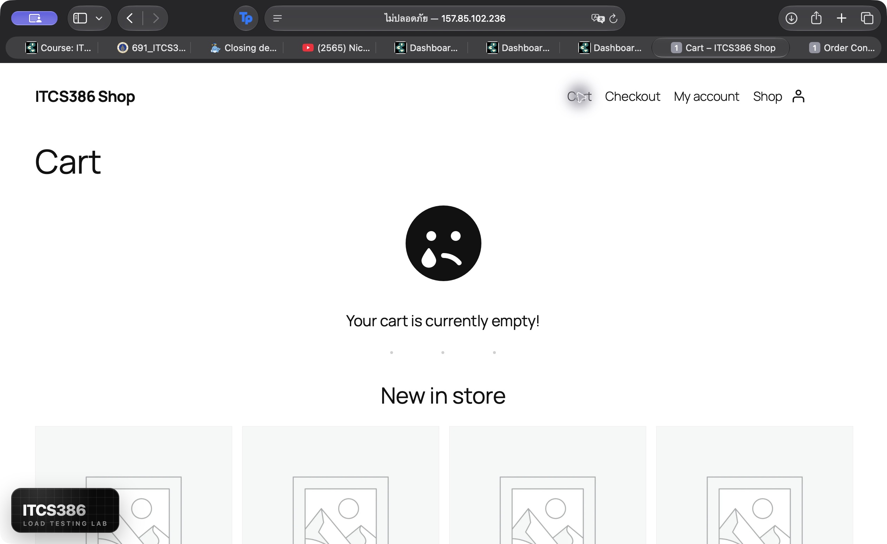

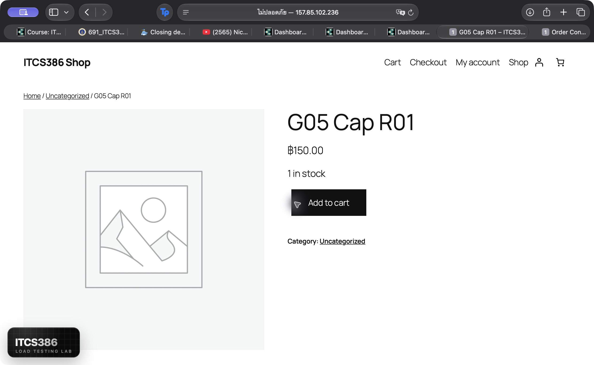

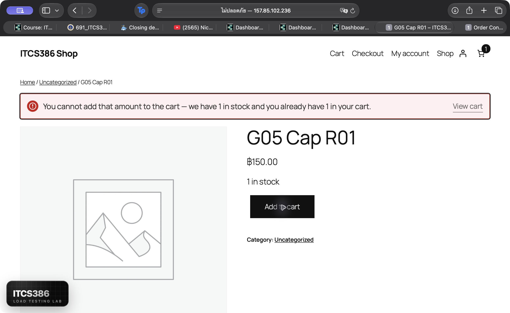

## Related documents

- [System test cases](system-test-cases.md#st-g05-02)
- [Traceability matrix](api-traceability-matrix.md)
