# ST-G05-03 — R01 Execution Report

**Scope: guest checkout, updated price and required-address validation.** Login and account history were removed at the user's request. No customer account coverage is claimed.

| Item | Recorded value |
|---|---|
| Execution | 17 November 2026, approximately 21:12–21:19 Asia/Bangkok; Codex Computer Use/browser UI |
| Staff / customer | In-app browser itcs386-g05 / separate Safari guest session |
| Product | G05 Tee R01, ID 775; price changed 250 → 225 THB |
| Valid order | 777, COD, 225 THB, Completed after reload |
| Accidental order | 776, Cancelled; stock restoration verified |
| Result | 7 revised checks passed after correcting an input-operation error in step 4 |
| Evidence | 12 step screenshots plus 2 incident/cleanup screenshots |

## Results

| Step | Action | Input data | Expected result | Actual result | Pass or fail |
|---|---|---|---|---|---|
| 1 | Staff publishes the product at the original regular price, then changes Regular price (฿), saves and reloads. | Product name = G05 Tee R01; Product data = Simple product; Regular price (฿) initially 250, then 225; Sale price (฿) blank; Stock management checked; Quantity 10; Allow backorders? = Do not allow; click Publish, then Update. | Published product retains the updated regular price of 225 THB after reopening. | Product 775 was published at 250 THB. After updating and reloading, Regular price (฿) showed 225; no sale price was used. | Pass |
| 2 | Guest opens Shop, locates the tee through the product list and clicks its name. | Shop page 1; target G05 Tee R01; use Next Page as needed; found on page 13 in this run. | Correct product appears at the updated price of 225 THB and is available to buy. | Found G05 Tee R01 through the Shop list on page 13. Product details displayed 225 THB and 10 in stock; no login or direct product URL used. | Pass |
| 3 | Guest adds one tee, opens View cart and then Proceed to Checkout. | Product quantity = 1; Add to cart; View cart; Proceed to Checkout. | Cart and checkout show one unit at 225 THB. | Cart and guest checkout showed one tee, quantity 1 and total 225 THB. No coupon was applied. | Pass |
| 4 | Guest fills the other required details, clears Street address, verifies it is empty, then clicks Place Order. | Email address = g05.tee.r01@example.com; First name G05; Last name Test; Country / Region Thailand; Street address empty; Town / City Bangkok; State / County Bangkok; Postcode / ZIP 10200; Phone (optional) 0800000000; Cash on delivery selected; order note unchecked. | Required-field validation is visible; no successful order confirmation appears and the form can be corrected. | On the corrected attempt, Street address was verified empty before submission. The page displayed Please enter a valid street address and remained at checkout. The first attempt had a test-operation error, documented below; it is not validation evidence. | Pass on corrected attempt |
| 5 | Guest corrects the required address and places the valid COD order. | Street address = 1 Test Road; remaining values unchanged; apartment/unit empty; no separate shipping form/method selector; click Place Order once after verifying all fields. | Confirmation shows an order number and merchandise price 225 THB, not 250 THB; grand total matches displayed shipping/tax. | Order 777 was confirmed for g05.tee.r01@example.com: G05 Tee R01 × 1, COD, total 225 THB. No additional shipping/tax line was shown. | Pass |
| 6 | Staff searches for the valid order and compares it with the guest confirmation. | Search orders: = 777; open #777 G05 Test; product G05 Tee R01 (ID 775); email g05.tee.r01@example.com. | Staff order product, quantity, price, email and total match the guest confirmation. | Order 777 was associated with Guest, not a registered account. Product 775, quantity 1, unit price/total 225 THB and email matched. Order notes recorded stock 10→9. | Pass |
| 7 | Staff changes the valid order to Completed, saves and reloads. | Order 777; Status = Completed; Update; reload the order. | Completed persists after reopening; product details and totals remain unchanged. | Order 777 remained Completed after reload; item and total stayed 225 THB. | Pass |

### Execution incident and cleanup

The first attempt to clear Street address removed only the final character, leaving `1 Test Roa`. The agent submitted before verifying the field and accidentally created order **776**. This was a **test-operation error**, not evidence that an empty address was accepted by the system.

Order 776 was changed to **Cancelled**. The saved order notes confirmed stock restoration from 9 to 10. The guest rebuilt the one-item cart through the Shop list and repeated the affected checkout steps. In the valid attempt, the empty field was explicitly verified before clicking Place Order; the required-field error appeared. Correcting it then produced order **777**, which is the order used for the final results.

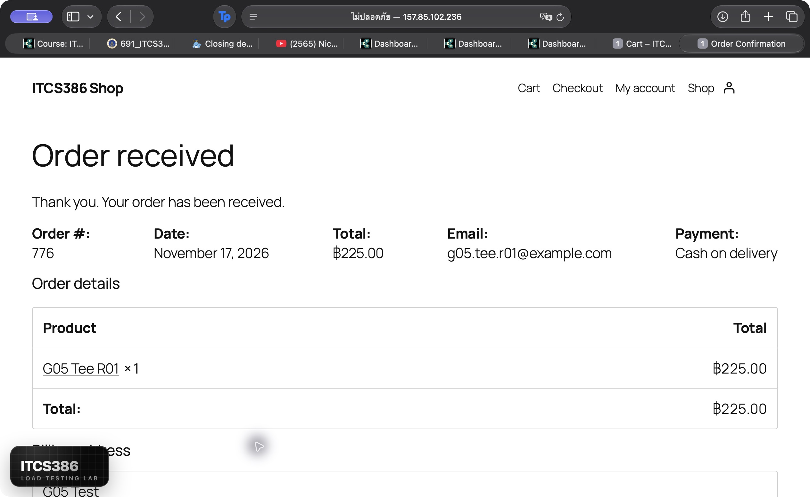

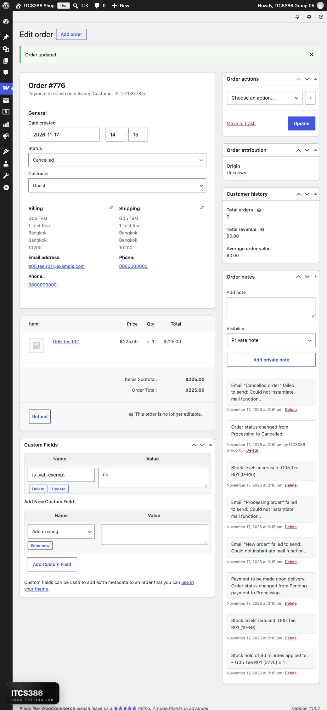

This report does not claim an error-free first attempt. The seven revised behavioral checks passed after correcting the input-clear operation. Both orders remain in the lab: 776 Cancelled, 777 Completed. No records belonging to other groups were changed.

### Observed checkout inputs

| UI label / control | Recorded value |
|---|---|
| Checkout mode | Guest; no customer account |
| Email address | g05.tee.r01@example.com |
| First name / Last name | G05 / Test |
| Country / Region | Thailand |
| Street address | Empty for validation; corrected to 1 Test Road |
| + Add apartment, suite, unit, etc. | Left closed; no second address line |
| Town / City | Bangkok |
| State / County | Bangkok |
| Postcode / ZIP | 10200 |
| Phone (optional) | 0800000000 |
| Cash on delivery | Selected |
| Add a note to your order | Unchecked |
| Separate shipping form / method | Not displayed; no same-as-billing checkbox was used |
| Company field | Not displayed |
| Total | 225 THB, quantity 1, no coupon |
| Billing values | Retained by the guest session and verified; email changed and Street address explicitly cleared/corrected |

New order, Processing order and Completed order email notifications reported “Could not instantiate mail function”. Email delivery was outside the revised case assertions. The staff view showed shipping details matching billing; this was a saved result, not a shipping-form input. Captures are unaltered and may include browser chrome or requester IP information.

### Test 3 — screenshots by step

#### Step 1

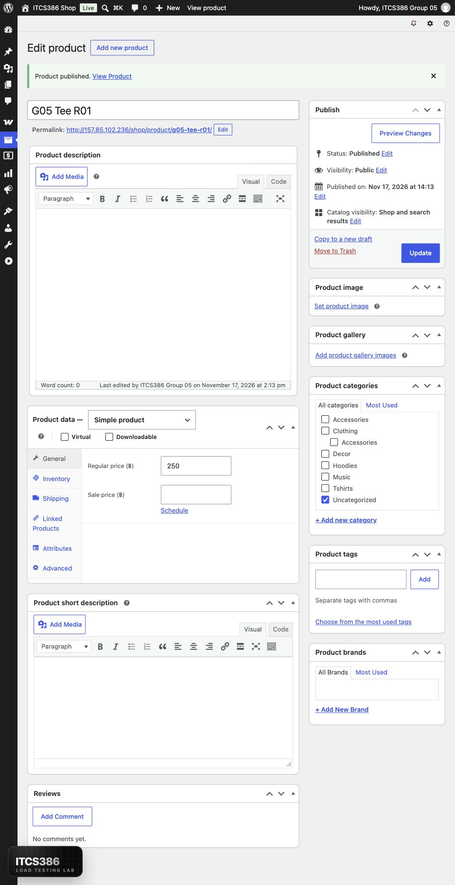

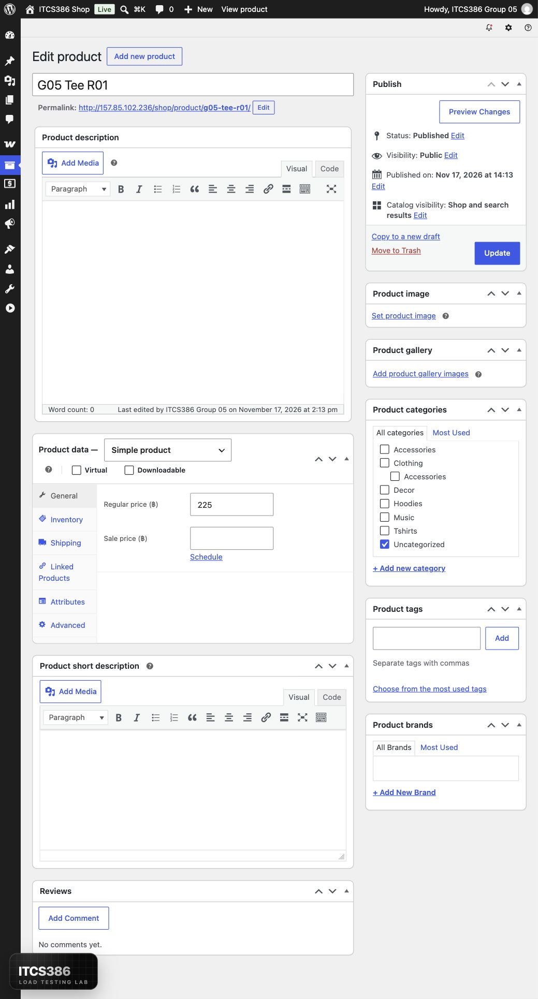

#### Step 2

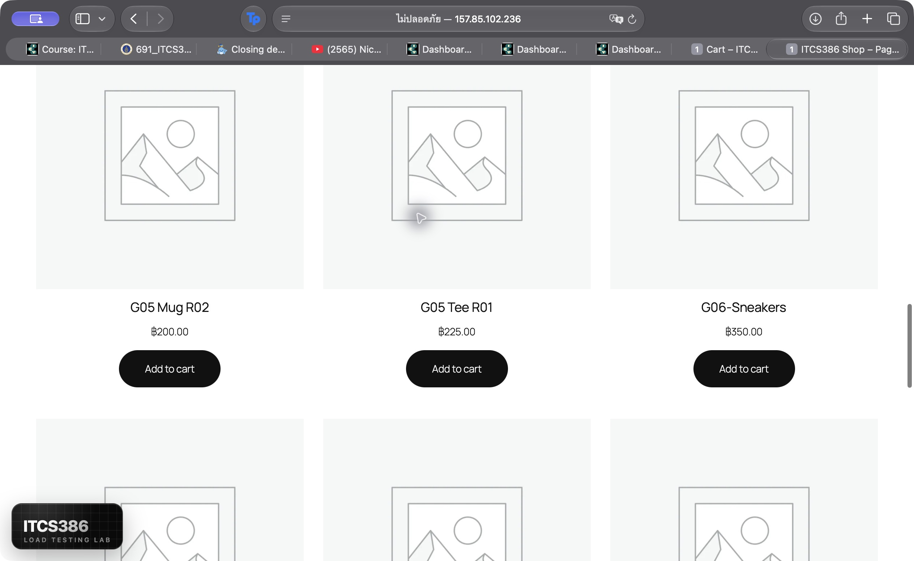

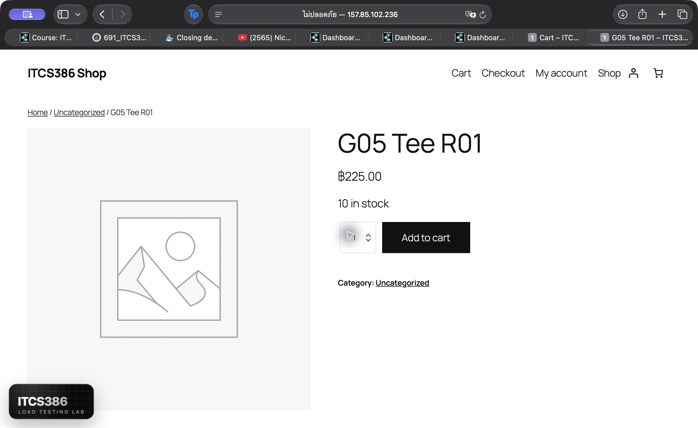

#### Step 3

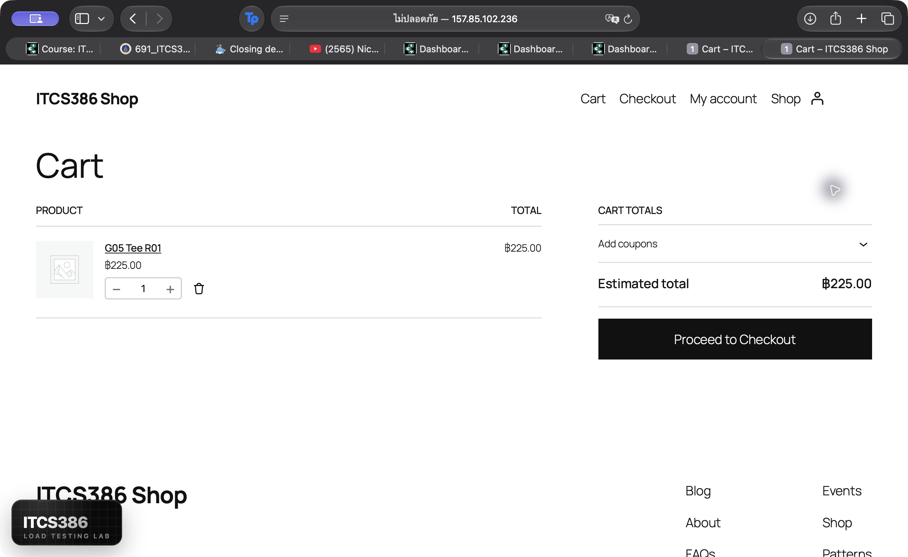

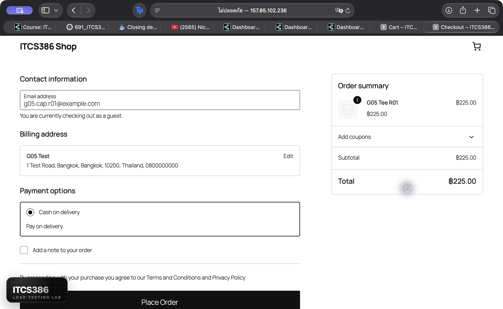

#### Step 4

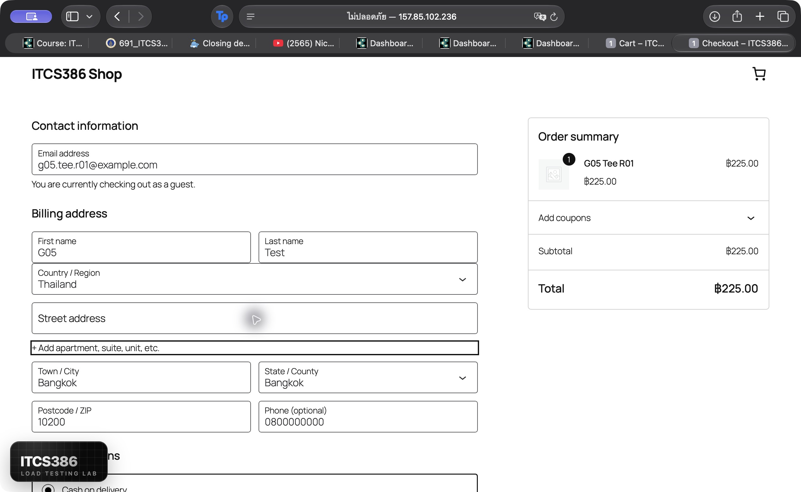

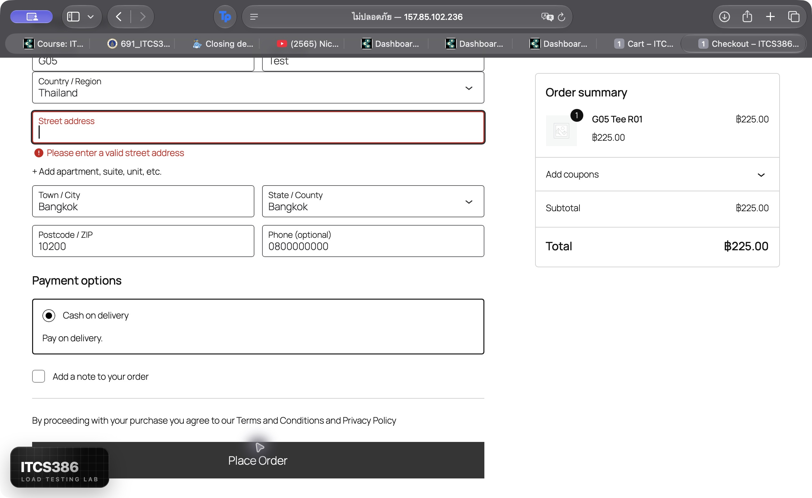

#### Step 5

#### Step 6

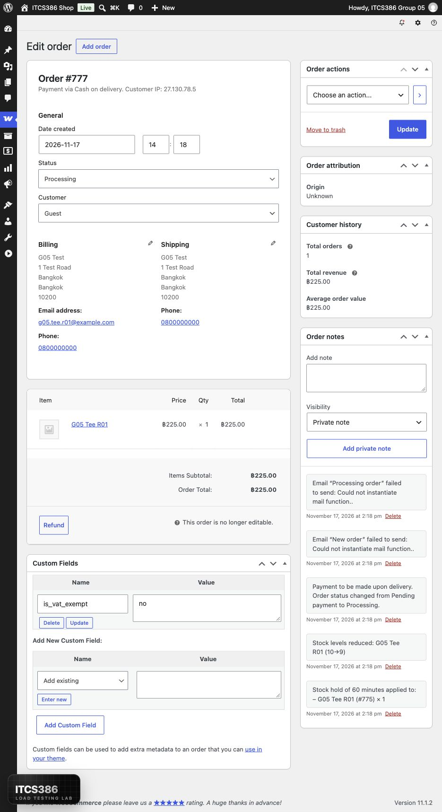

#### Step 7

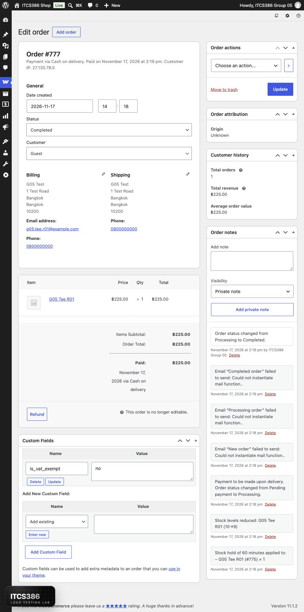

## Related documents

- [System test cases](system-test-cases.md#st-g05-03)
- [Traceability matrix](api-traceability-matrix.md)
