# ST-G05-03 — R02 Execution Report

| Item | Recorded value |
|---|---|
| Date and time | 19 November 2026, 03:12–03:15 Asia/Bangkok |
| Product | `G05 Tee R02`, ID 1261 |
| Order | 1274, 225 THB, Cash on delivery |
| Recorded order status | Completed |
| Result | **7/7 Pass** |
| Screenshots | 15 page-only captures |

## Step results

| Step | Action | Input data | Expected result | Actual result | Pass or fail |
|---|---|---|---|---|---|
| 1 | Create and publish the tee at 250 THB, then change its regular price to 225 THB, Update and reload. | Product name = G05 Tee R02; Simple product; Regular price (฿) initially 250, then 225; Sale price blank; Stock management checked; Quantity = 10; Allow backorders? = Do not allow. | Published product retains the updated regular price of 225 THB after reopening. | Product 1261 was newly published at 250 THB; after Update and reload, regular price was 225. Blank form, pre-Publish inputs, initial publication and updated price captured. | Pass |
| 2 | Log out as staff and find/open the tee through the Shop list as guest. | Shop page 1; target G05 Tee R02; Next Page as needed; click the matching name. | Correct product appears at the updated price of 225 THB and is available to buy. | Found the tee on Shop page 15. Product page showed 225 THB and 10 in stock; no customer login or direct product URL used. | Pass |
| 3 | Add one tee and open checkout through the cart. | Product quantity = 1; Add to cart; View cart; Proceed to Checkout. | Cart and checkout show one unit at 225 THB. | Cart and guest checkout showed one tee at 225 THB with no coupon. | Pass |
| 4 | Fill the other required fields, verify Street address is empty, then attempt Place Order. | Email g05.tee.r02@example.com; First name G05; Last name Test; Thailand; Street address empty; Town / City Bangkok; State / County Bangkok; Postcode / ZIP 10200; Phone 0800000000; Cash on delivery. | Required-field validation is visible; no successful order confirmation appears and the form can be corrected. | The genuinely empty Street address produced Please enter a valid street address. The page remained at checkout; no successful confirmation appeared. | Pass |
| 5 | Correct Street address and place the valid order. | Street address = 1 Test Road; Tab; verify correction; other values unchanged; note unchecked; Place Order once. | Confirmation shows an order number and merchandise price 225 THB, not 250 THB; grand total matches displayed shipping/tax. | Order 1274 confirmed: one G05 Tee R02, COD, subtotal/total 225 THB, not the old 250 THB price. No separate shipping/tax charge. | Pass |
| 6 | Sign in as staff, find the order and compare with the confirmation. | Search orders: = 1274; open #1274 G05 Test; product 1261; email g05.tee.r02@example.com. | Staff order product, quantity, price, email and total match the guest confirmation. | Order was Guest with correct product, quantity 1, unit price/total 225 THB and email. Order notes recorded stock 10→9. | Pass |
| 7 | Set Completed, save and reload. | Order 1274; Status = Completed; Update; reload. | Completed persists after reopening; product details and totals remain unchanged. | Completed persisted after reload and the item/total remained 225 THB. | Pass |

### Checkout inputs used

| UI field / control | Value / action |
|---|---|
| Checkout mode | Guest, after staff logout |
| Email address | `g05.tee.r02@example.com` |
| First name | `G05` |
| Last name | `Test` |
| Country / Region | `Thailand` (verified selected) |
| Street address | Empty for step 4; explicitly verified before submission; corrected to `1 Test Road` in step 5 |
| + Add apartment, suite, unit, etc. | Left closed; second address line blank |
| Town / City | `Bangkok` |
| State / County | `Bangkok` selected from the dropdown |
| Postcode / ZIP | `10200` |
| Phone (optional) | `0800000000` |
| Payment | Cash on delivery selected |
| Add a note to your order | Unchecked |
| Separate shipping form / same-as-billing checkbox | Not displayed; no such input was made |
| Shipping method / Company field | Not displayed |
| Submission | One rejected empty-address attempt, followed by one successful corrected submission |
| Recorded total | 225.00 THB; no separate shipping/tax charge shown |

The form fields were filled for this run. No real customer account or real personal details were used. The staff order showed shipping details matching billing; that is an observed saved value, not evidence of a shipping checkbox.

## Screenshots by step

### Step 1 — Pass

**Add new product — blank form before entering data**

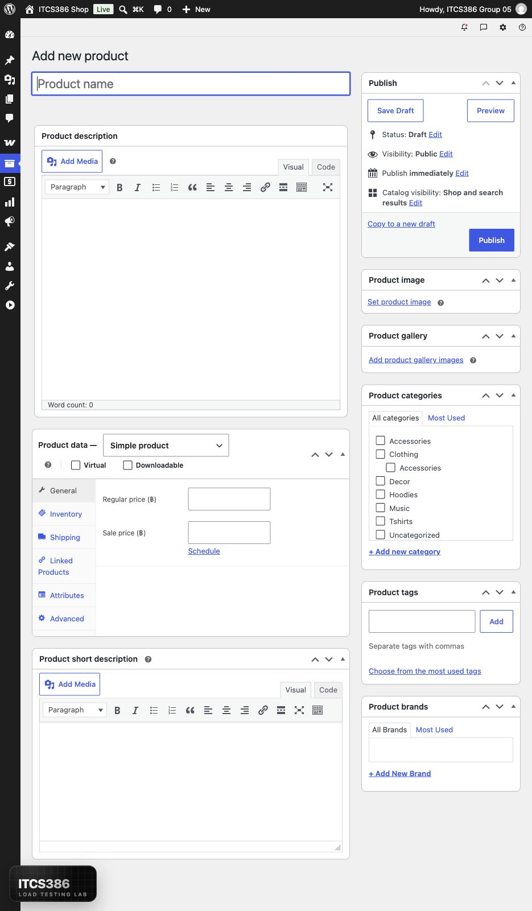

**Add new product — inventory entered, before Publish**

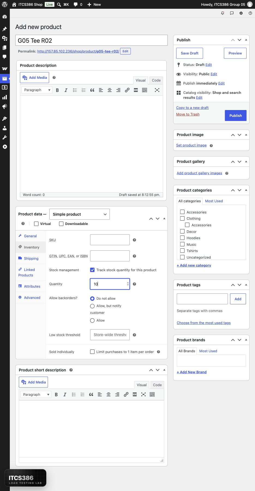

**Add new product — price entered, before Publish**

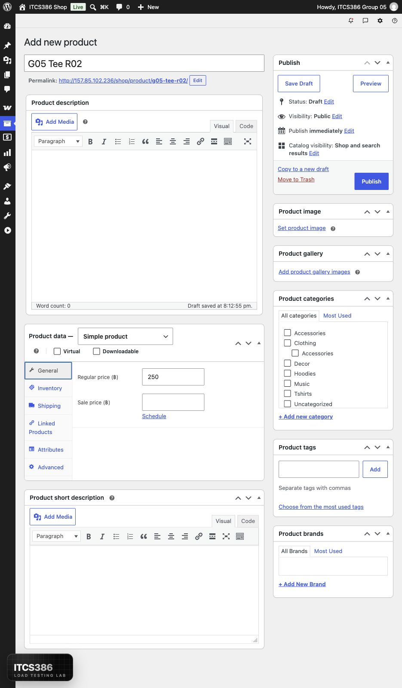

**New product published at the original 250 THB price**

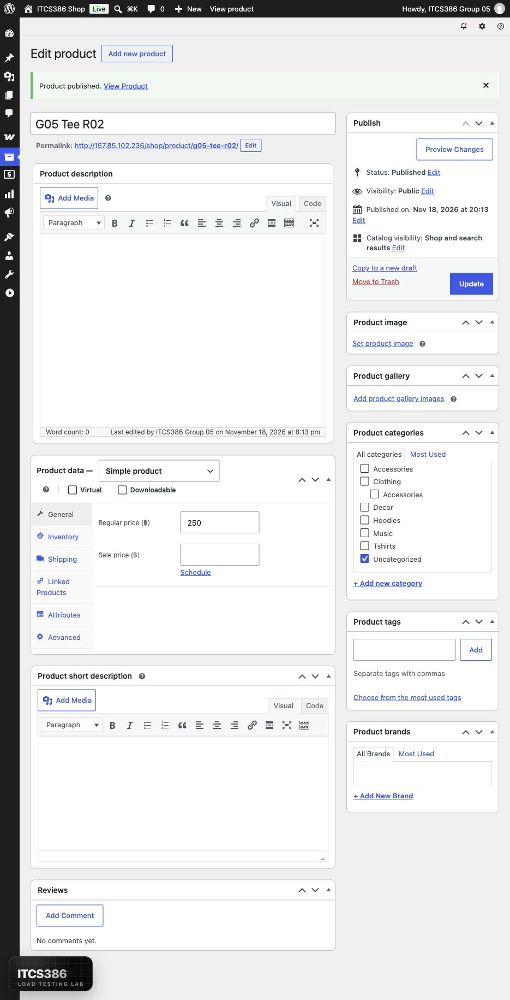

**Regular price changed to 225 THB, saved and reloaded**

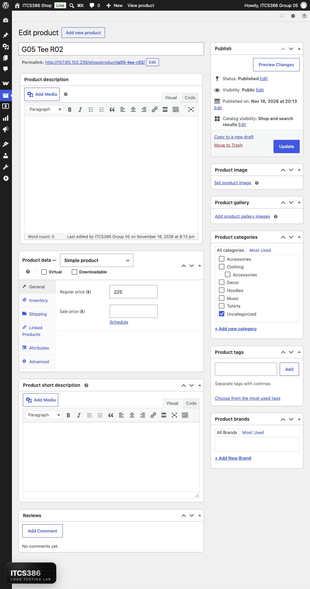

### Step 2 — Pass

**Tee located in the Shop list**

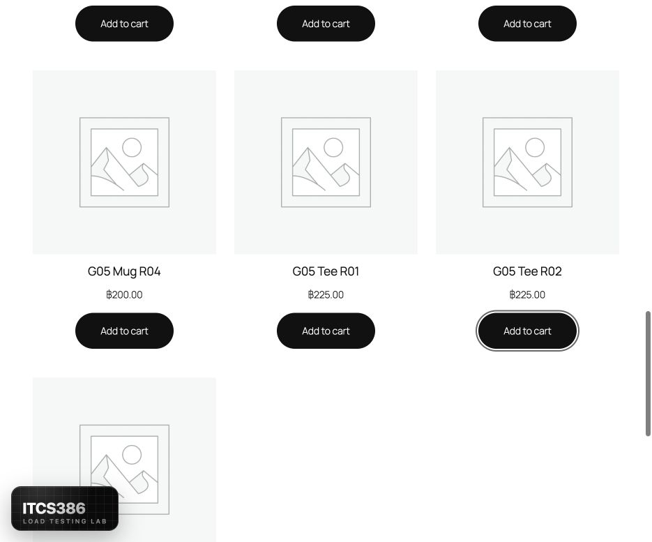

**Tee detail shows the updated 225 THB price**

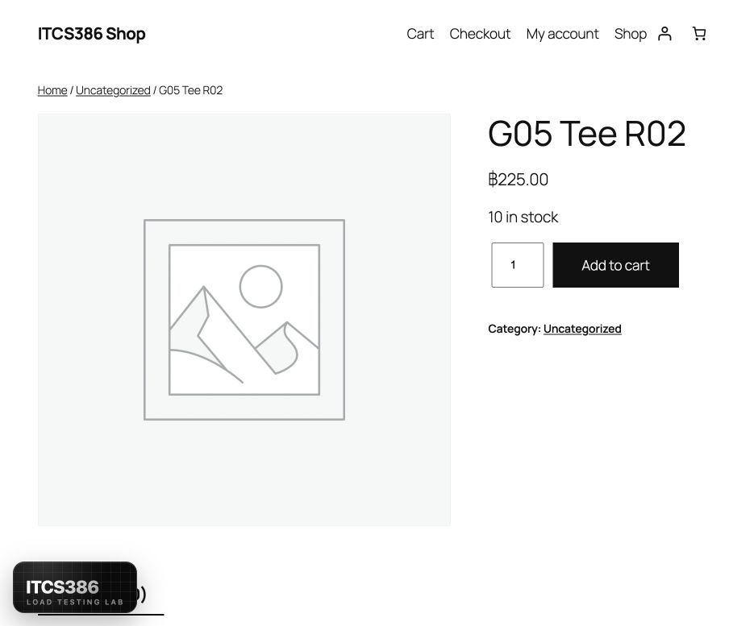

### Step 3 — Pass

**One tee in the cart at 225 THB**

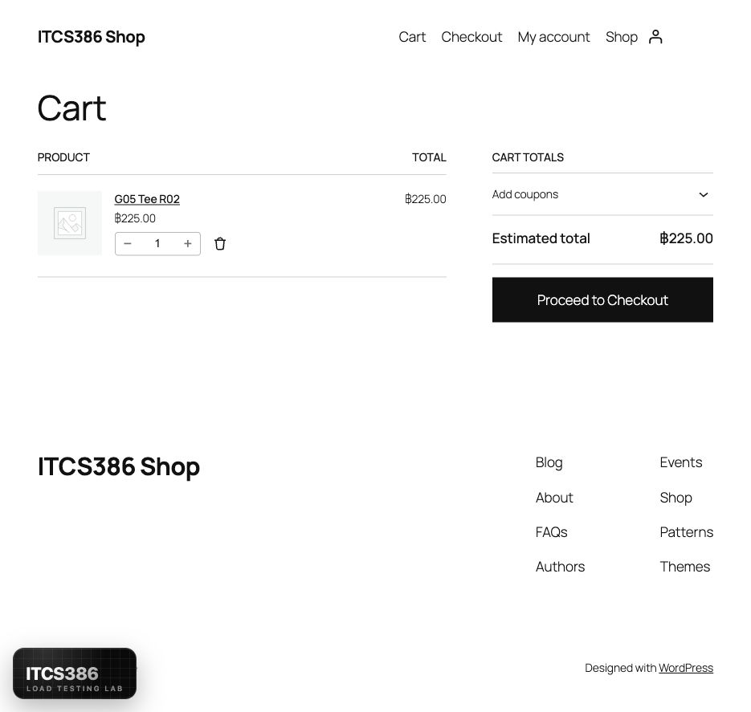

**Guest checkout at 225 THB**

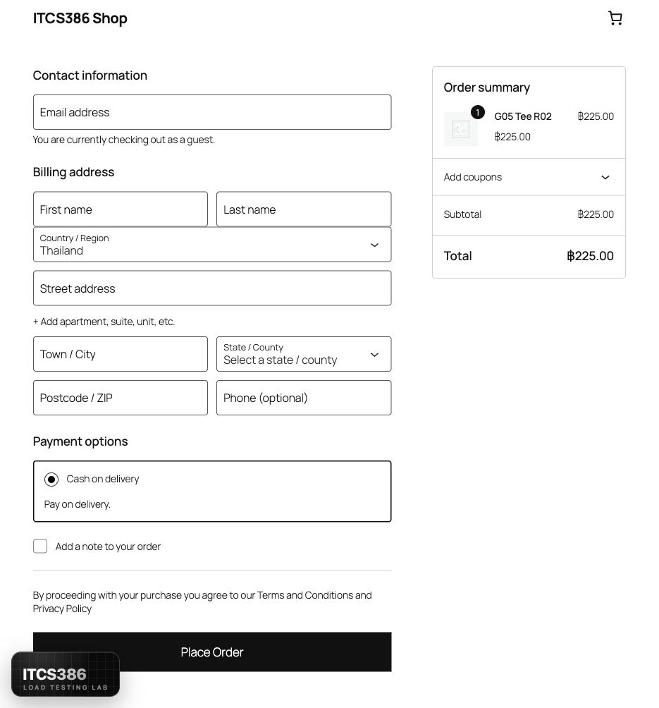

### Step 4 — Pass

**Street address verified empty before submission**

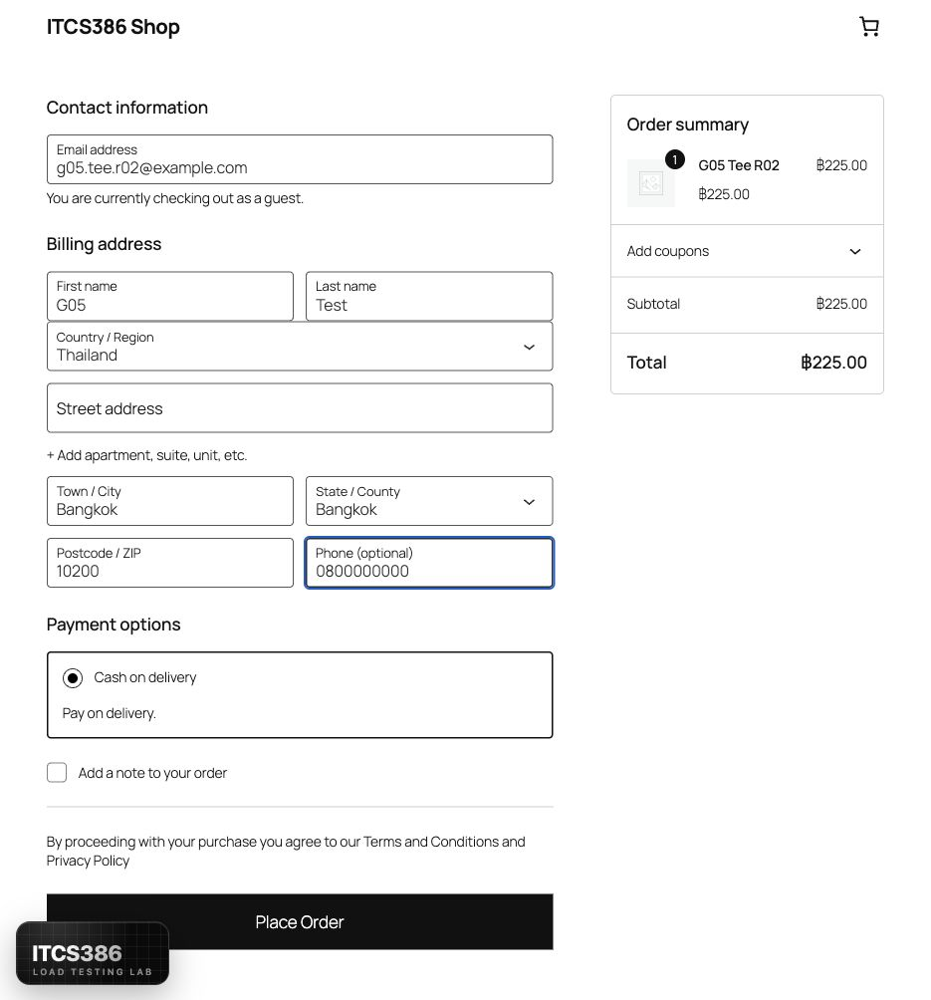

**Required-field validation prevents checkout**

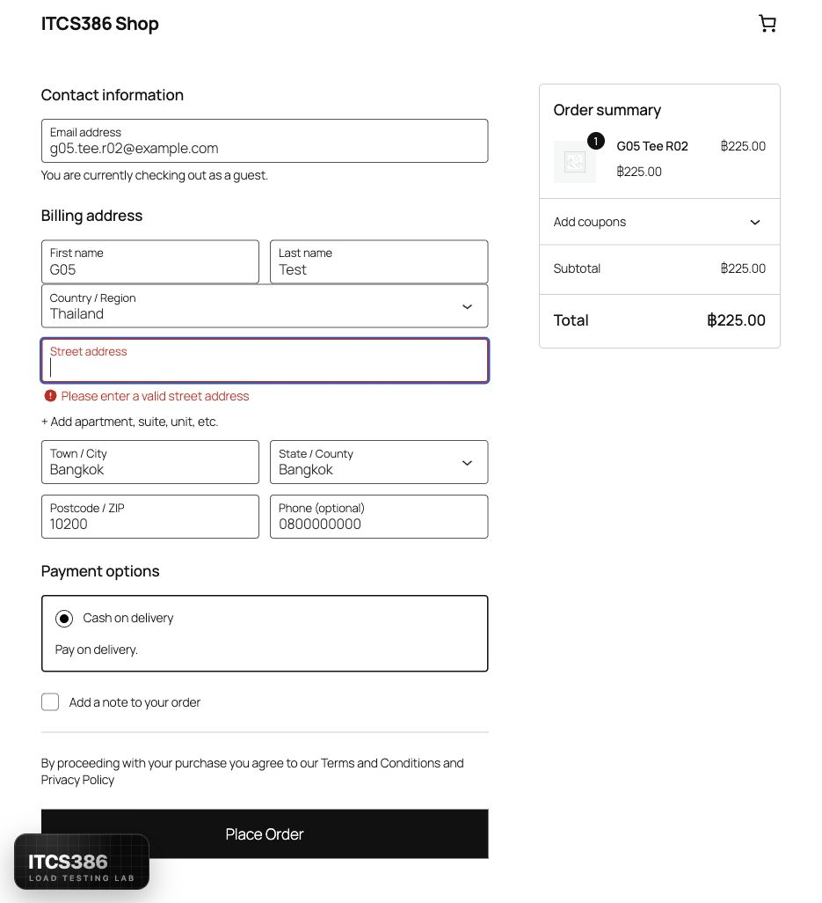

### Step 5 — Pass

**Street address corrected to 1 Test Road**

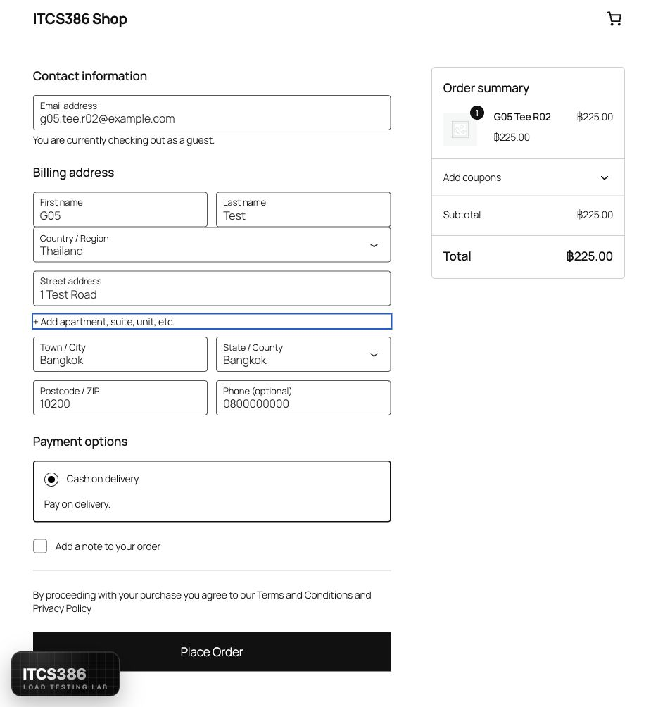

**Corrected guest order confirmed at 225 THB**

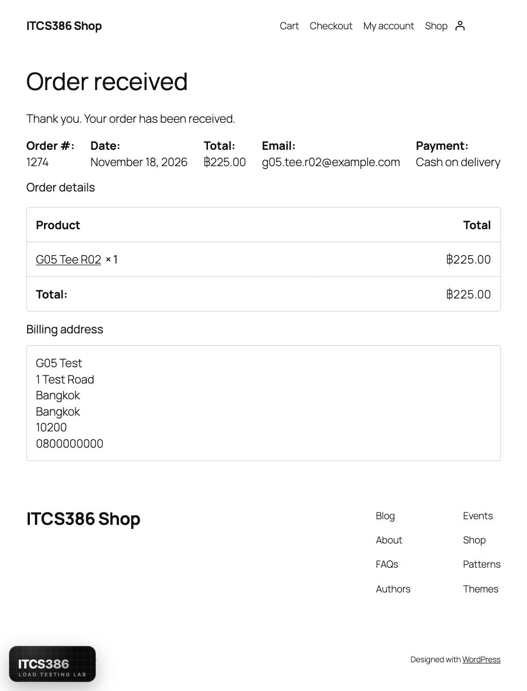

### Step 6 — Pass

**Staff order matches the guest purchase**

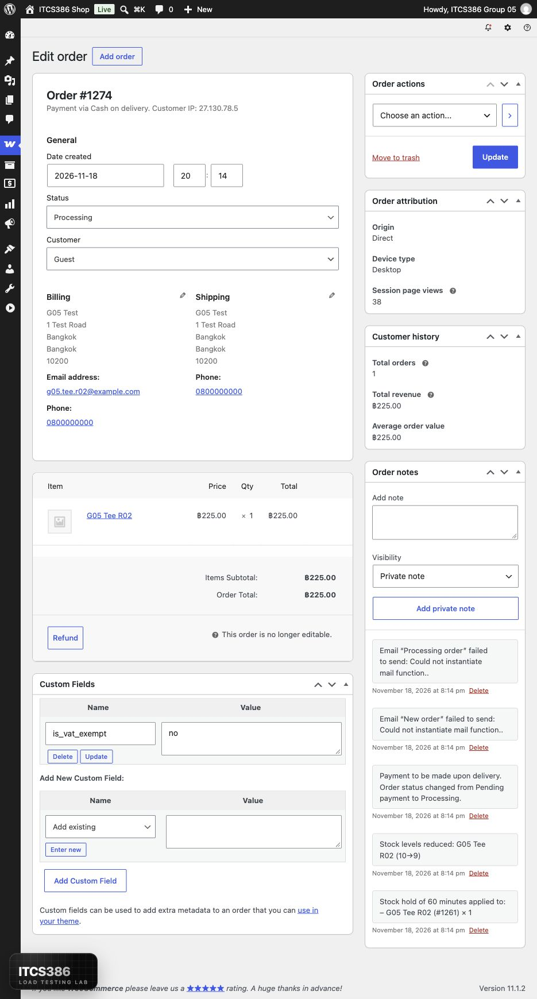

### Step 7 — Pass

**Completed status persists after reload**

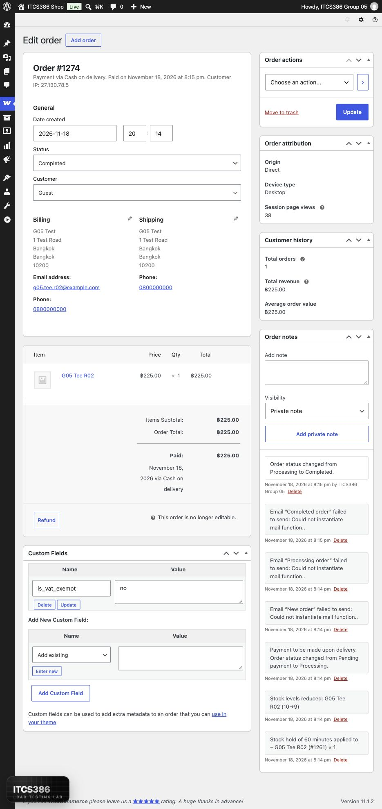
