# System Test Cases — ITCS386 Group 5

## ST-G05-01

| Field | Details |
|---|---|
| Test case ID | ST-G05-01 |
| Title | Purchase with a coupon and complete the order |
| Objective | Verify creation of a new product and restricted coupon, invalid-coupon rejection, discounted guest checkout and staff order completion. |
| Preconditions | Staff logged in as itcs386-g05 for setup; new test name unused; logout before guest shopping; empty guest cart; Cash on delivery available. |
| Test data | `G05 Mug R04`, new product ID `1250`; price 200 THB; initial stock 20; purchase quantity 2; email `g05.mug.r04@example.com`. Coupon `G05SAVE10-R04` (ID 1251), 10%, restricted to this product; invalid code `G05BAD-R04`. Order `1252`, 360 THB, recorded status Completed. |
| Date and time | 19 November 2026, 03:01–03:07 Asia/Bangkok |
| Recorded run | R04; 9/9 Pass |

[Open the execution report](ST-G05-01-R04-results.md).

| Step | Action | Input data | Expected result | Actual result | Pass or fail |
|---|---|---|---|---|---|
| 1 | Open Add new product, capture the blank form, fill the product fields, capture the form before Publish, then publish and verify saved price/stock. | Product name = G05 Mug R04; Product data = Simple product; Regular price (฿) = 200; Sale price (฿) blank; Stock management checked; Quantity = 20; Allow backorders? = Do not allow; Publish. | Product is published with the specified price and stock. | New product 1250 was created. Blank Add new product, completed form with Draft/Publish, Product published and saved stock 20 were captured. Price persisted at 200 THB. | Pass |
| 2 | Create and publish a new percentage coupon restricted to the newly created mug. | Coupon code = G05SAVE10-R04; Discount type = Percentage discount; Coupon amount = 10; Usage restriction > Products = G05 Mug R04 (#1250); Minimum spend = 0; maximum/expiry/usage-limit fields blank. | Coupon is saved with the correct product restriction and discount. | Coupon 1251 was published at 10% and its saved product restriction contained only G05 Mug R04 (#1250). | Pass |
| 3 | Log out of the staff account, open Shop as a guest, find the mug through the product list and click its name. | Start at http://157.85.102.236/shop/; exact name G05 Mug R04; follow Next Page as needed. No storefront search or direct product URL. | Correct product appears at 200 THB and is available to buy. | Guest cart was empty. Located G05 Mug R04 in the Shop list on page 15, opened it, and observed 200 THB / 20 in stock. | Pass |
| 4 | Set Product quantity to two, click Add to cart and open View cart. | Product quantity = 2 for G05 Mug R04; Add to cart; View cart. | Cart contains two units with merchandise subtotal 400 THB. | Cart contained one line, quantity 2, unit price 200 THB and subtotal 400 THB. | Pass |
| 5 | Try the nonexistent coupon, then apply the valid coupon. | Add coupons > Enter code = G05BAD-R04; Apply. Then Enter code = G05SAVE10-R04; Apply. | Invalid code produces a visible error without changing the total. Valid code applies one 40 THB discount; discounted merchandise total is 360 THB. | Invalid code was rejected as nonexistent with total unchanged at 400 THB. Valid coupon applied a 40 THB discount and total became 360 THB. | Pass |
| 6 | Open checkout, then return through Cart without placing an order. | Proceed to Checkout; click Cart; do not click Place Order. | Product, quantity and coupon remain correct; no successful order confirmation appears. | Quantity 2, applied coupon and 360 THB total remained after returning to the cart. | Pass |
| 7 | Reopen checkout, fill the guest form and place one COD order. | Use the complete checkout-input table below: g05.mug.r04@example.com; G05 Test; 1 Test Road; Bangkok / Bangkok; 10200; Thailand; 0800000000; Cash on delivery; note unchecked; Place Order once. | Confirmation shows an order number, two units, the 40 THB discount and the correct grand total. | Guest order 1252 confirmed: quantity 2, subtotal 400 THB, discount 40 THB, total 360 THB, Cash on delivery. No separate shipping/tax charge displayed. | Pass |
| 8 | Sign back in as staff, search Orders and compare the new order with the guest confirmation. | Search orders: = 1252; open #1252 G05 Test; verify product 1250, coupon 1251 and email g05.mug.r04@example.com. | Order details, coupon and total agree with the customer confirmation. | Staff order details matched the guest confirmation: two mugs, coupon discount 40 THB, total 360 THB. Notes recorded stock 20→18. | Pass |
| 9 | Change the order to Completed, save and reload. | Order 1252; Status = Completed; Update; reload. | Completed persists; order contents and totals are unchanged. | Completed persisted after reload; items and total remained 360 THB. | Pass |

### Checkout inputs used

| UI field / control | Value / action |
|---|---|
| Checkout mode | Guest, after staff logout |
| Email address | `g05.mug.r04@example.com` |
| First name | `G05` |
| Last name | `Test` |
| Country / Region | `Thailand` (verified selected) |
| Street address | `1 Test Road` |
| + Add apartment, suite, unit, etc. | Left closed; second address line blank |
| Town / City | `Bangkok` |
| State / County | `Bangkok` selected from the dropdown |
| Postcode / ZIP | `10200` |
| Phone (optional) | `0800000000` |
| Payment | Cash on delivery selected |
| Add a note to your order | Unchecked |
| Separate shipping form / same-as-billing checkbox | Not displayed; no such input was made |
| Shipping method / Company field | Not displayed |
| Submission | Place Order clicked once for the successful order |
| Recorded total | 360.00 THB; no separate shipping/tax charge shown |

The form fields were filled for this run. No real customer account or real personal details were used. The staff order showed shipping details matching billing; that is an observed saved value, not evidence of a shipping checkbox.

### Run observations

During initial catalog navigation, one click opened an unrelated demo-product page. Returned to the catalog without adding or changing that product, then continued through Next Page with navigation checks. The tested mug was opened from its own list entry on page 15. No extra order was placed.

### Screenshots by step

#### Step 1 — Pass

**Add new product — blank form before entering data**

**Add new product — inventory entered, before Publish**

**Add new product — price entered, before Publish**

**Product published — confirmation after creating the new product**

**Saved stock settings after creation**

#### Step 2 — Pass

**New coupon configured before Publish**

**Saved 10% discount**

**Saved restriction to the newly created mug**

#### Step 3 — Pass

**Guest Shop list at the start of browsing**

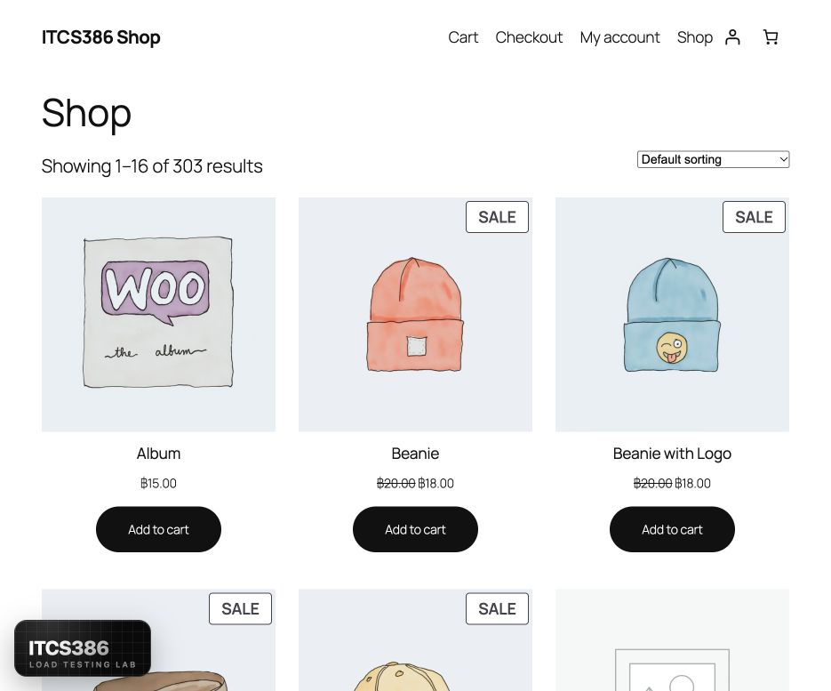

**Matching mug located in the Shop list**

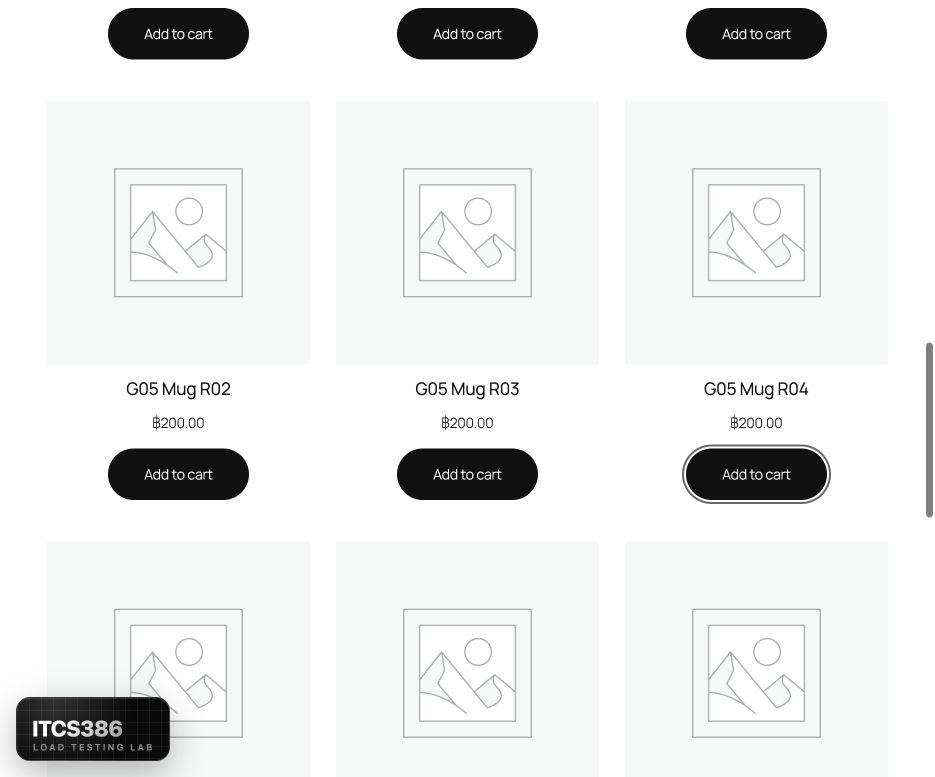

**Mug details opened from its list entry**

#### Step 4 — Pass

**Two mugs, subtotal 400 THB**

#### Step 5 — Pass

**Invalid coupon rejected**

**Valid coupon applied: 40 THB discount**

#### Step 6 — Pass

**Checkout opened before returning to Cart**

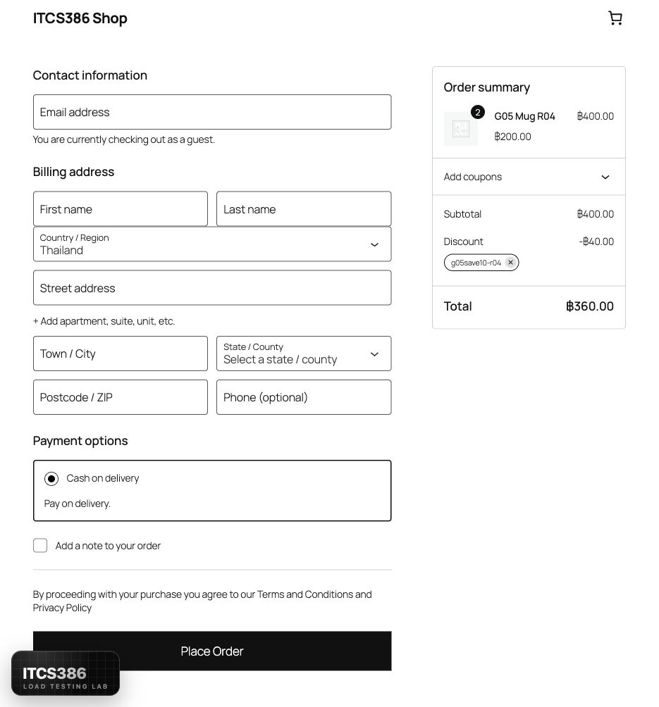

**Returned cart retains quantity and discount**

#### Step 7 — Pass

**Completed guest checkout inputs**

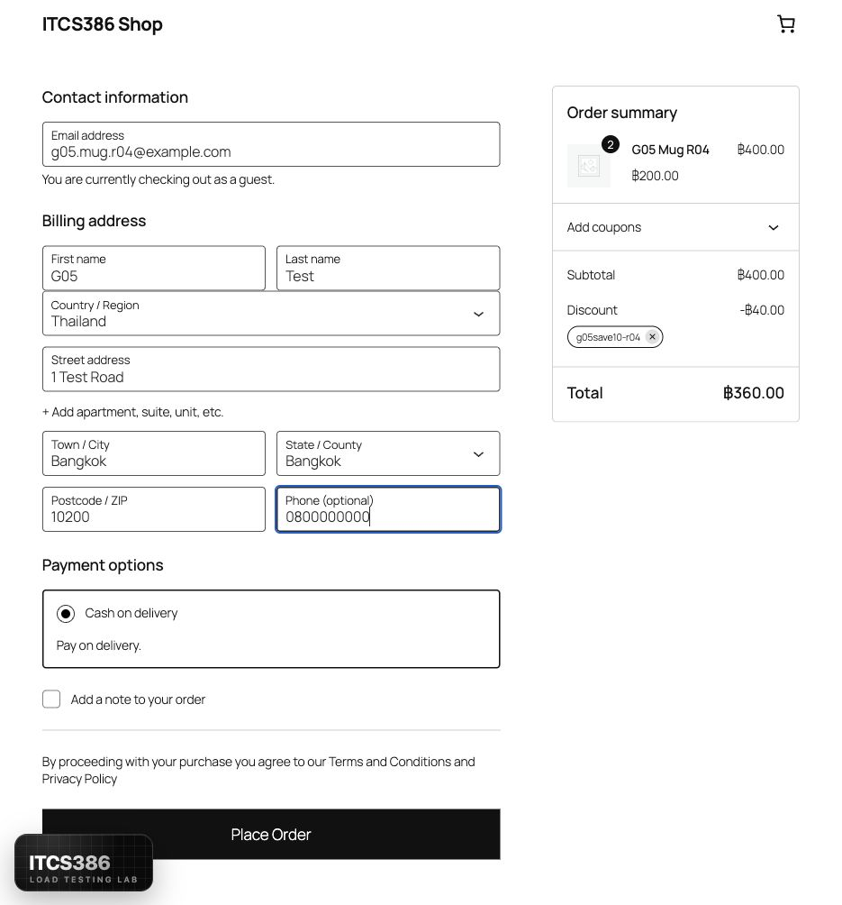

**Customer order confirmation**

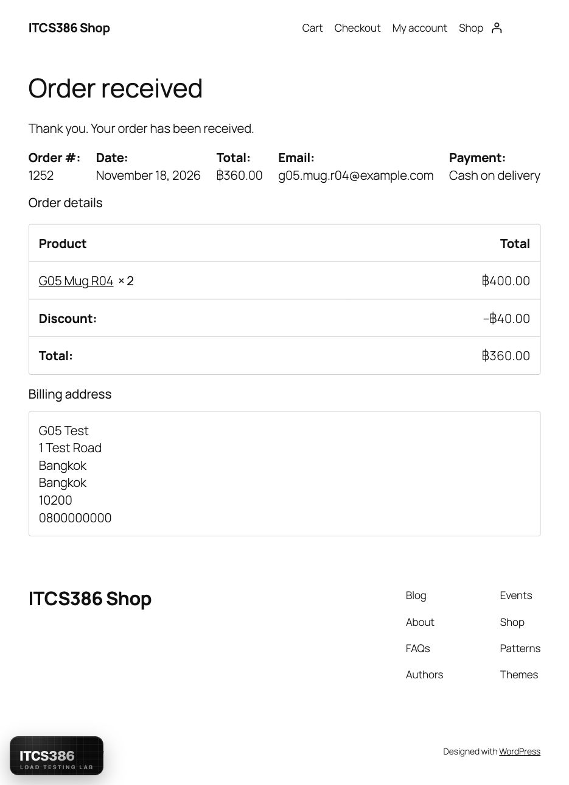

#### Step 8 — Pass

**Staff order details**

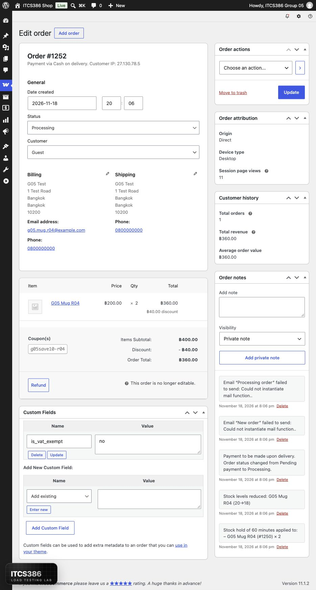

#### Step 9 — Pass

**Completed status persisted after reload**

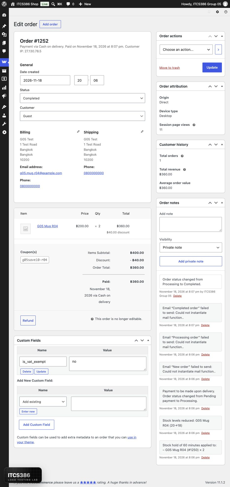

## ST-G05-02

| Field | Details |
|---|---|
| Test case ID | ST-G05-02 |
| Title | Validate quantity limits and remaining stock |
| Objective | Verify stock-limit enforcement, cart quantity edits/removal, a guest purchase and the remaining-stock limit. |
| Preconditions | Staff logged in as itcs386-g05 for setup; new test name unused; logout before guest shopping; empty guest cart; Cash on delivery available. |
| Test data | `G05 Cap R02`, new product ID `1253`; price 150 THB; initial stock 3; purchase quantity 2; email `g05.cap.r02@example.com`. Order `1260`, 300 THB, recorded status Processing. |
| Date and time | 19 November 2026, 03:08–03:12 Asia/Bangkok |
| Recorded run | R02; 9/9 Pass |

[Open the execution report](ST-G05-02-R02-results.md).

| Step | Action | Input data | Expected result | Actual result | Pass or fail |
|---|---|---|---|---|---|
| 1 | Create a new cap through Add new product; capture blank and completed forms, Publish, then verify saved Inventory values. | Product name = G05 Cap R02; Simple product; Regular price (฿) = 150; Sale price blank; Stock management checked; Quantity = 3; Allow backorders? = Do not allow; Sold individually unchecked. | Product is published at 150 THB with stock 3 and no backorders. | Product 1253 was newly published at 150 THB with stock 3, backorders disabled and Sold individually unchecked. Before/after creation evidence captured. | Pass |
| 2 | Log out as staff, open Shop as guest, locate the cap in the list, open it and add one unit. | Target G05 Cap R02; Next Page as needed; Product quantity = 1; Add to cart; View cart. | Correct product appears at 150 THB; cart contains one unit with merchandise subtotal 150 THB. | Found the cap on Shop page 13, verified 150 THB / 3 in stock, and added one. Cart quantity was 1 and total 150 THB. | Pass |
| 3 | Attempt to change the cart quantity to four and leave the field. | Quantity of G05 Cap R02 in your cart. = attempted 4; press Tab; stock before attempt = 3. | The excessive quantity is prevented or rejected with visible feedback; cart does not retain more than stock 3. | The UI capped the value at 3, disabled Increase quantity, and displayed total 450 THB. No error banner appeared; limiting the value was the visible feedback. | Pass |
| 4 | Change the cart quantity to two. | Quantity of G05 Cap R02 in your cart. = 2; Tab. No Update cart button was used. | Cart updates to two units and merchandise subtotal 300 THB. | Quantity became 2 and total 300 THB. | Pass |
| 5 | Remove the product from the cart. | Trash control labelled Remove G05 Cap R02 from cart. | Cart becomes empty with no remaining merchandise charge for the product. | The cart displayed Your cart is currently empty!; no test-product charge remained. | Pass |
| 6 | Return to the product with browser Back and add two units again. | Product quantity = 2; Add to cart; View cart. | Cart contains exactly two units with merchandise subtotal 300 THB and no duplicate line. | Exactly one cart line with quantity 2 and total 300 THB; no duplicate item or coupon. | Pass |
| 7 | Fill the guest checkout form and place a COD order. | Complete checkout table below: g05.cap.r02@example.com; G05 Test; 1 Test Road; Bangkok / Bangkok; 10200; Thailand; 0800000000; COD; no note. | Confirmation shows an order number, two units and merchandise total 300 THB; grand total matches displayed shipping/tax. | Order 1260 confirmed for two caps at 150 THB each, total 300 THB, COD. No separate shipping/tax charge displayed. | Pass |
| 8 | Sign in as staff, find the order, then inspect the product Inventory. | Search orders: = 1260; open #1260 G05 Test; open G05 Cap R02 (#1253); Inventory > Quantity. | Order quantity is two and remaining stock is one. Earlier cart changes did not cause extra permanent stock deductions. | Order 1260 matched the purchase and remained Processing. Notes recorded 3→1; saved Quantity was 1. Cart edits had not permanently reduced additional stock. | Pass |
| 9 | Log out, verify an empty guest cart, reopen the cap through Shop and attempt a total of two units. | At 1 in stock the Product quantity field is absent. Click Add to cart once, then again. Open View cart after the second attempt. | The system prevents adding more than the one unit remaining. | First click added one. Second was rejected because stock was 1 and one was already in the cart. Cart retained quantity 1 and 150 THB; Increase quantity disabled. The unpurchased item was removed after evidence capture. | Pass |

### Checkout inputs used

| UI field / control | Value / action |
|---|---|
| Checkout mode | Guest, after staff logout |
| Email address | `g05.cap.r02@example.com` |
| First name | `G05` |
| Last name | `Test` |
| Country / Region | `Thailand` (verified selected) |
| Street address | `1 Test Road` |
| + Add apartment, suite, unit, etc. | Left closed; second address line blank |
| Town / City | `Bangkok` |
| State / County | `Bangkok` selected from the dropdown |
| Postcode / ZIP | `10200` |
| Phone (optional) | `0800000000` |
| Payment | Cash on delivery selected |
| Add a note to your order | Unchecked |
| Separate shipping form / same-as-billing checkbox | Not displayed; no such input was made |
| Shipping method / Company field | Not displayed |
| Submission | Place Order clicked once for the successful order |
| Recorded total | 300.00 THB; no separate shipping/tax charge shown |

The form fields were filled for this run. No real customer account or real personal details were used. The staff order showed shipping details matching billing; that is an observed saved value, not evidence of a shipping checkbox.

### Run observations and cleanup

Attempted cart quantity 4 was capped at 3 with no error banner. At remaining stock 1 the product page hid quantity input; two Add to cart clicks tested the total-of-two attempt. The second click was rejected. The unpurchased unit was removed after capture and the cart was confirmed empty. Order 1260 remains Processing as recorded; completing it is not a Test 2 step.

### Screenshots by step

#### Step 1 — Pass

**Add new product — blank form before entering data**

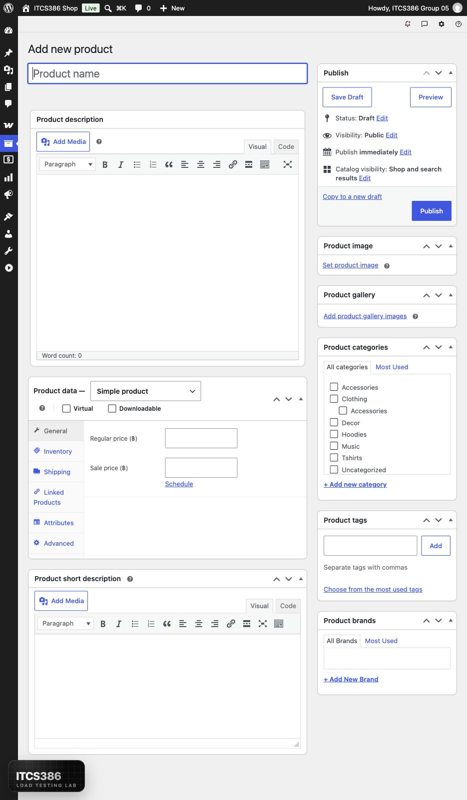

**Add new product — inventory entered, before Publish**

**Add new product — price entered, before Publish**

**Product published — confirmation after creating the new product**

**Saved stock settings after creation**

#### Step 2 — Pass

**Guest Shop list with an empty cart**

**Cap located in the Shop list**

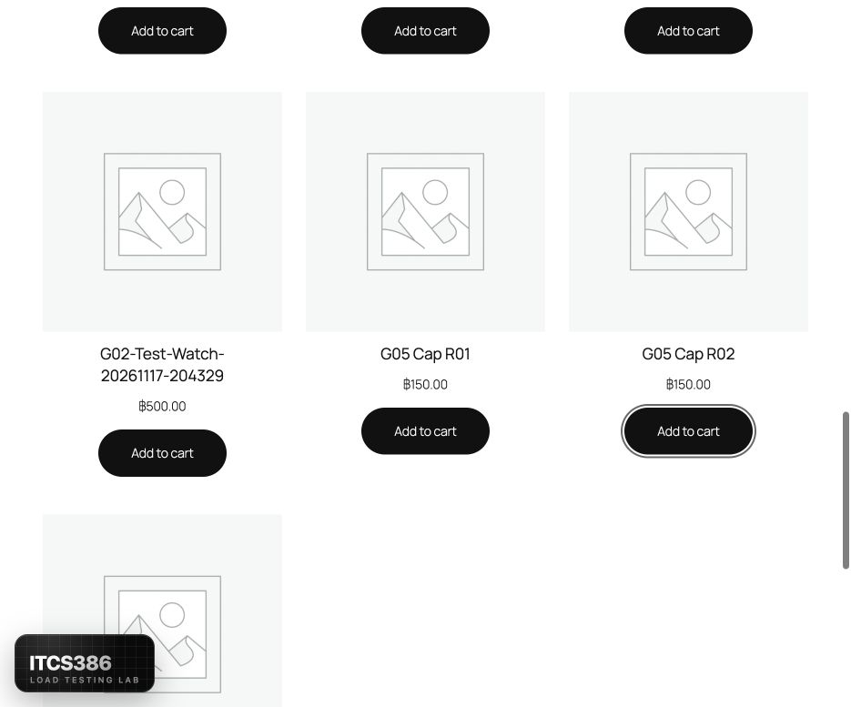

**Cap detail: 150 THB and 3 in stock**

**One cap in cart, total 150 THB**

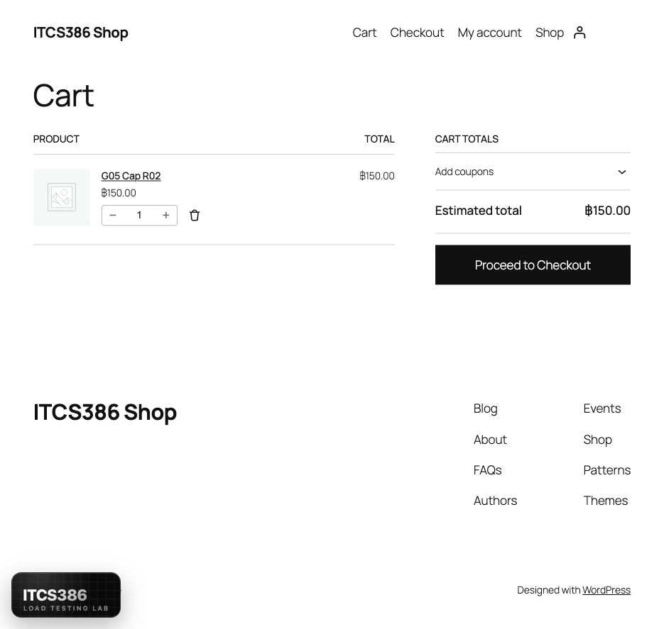

#### Step 3 — Pass

**Attempted 4 capped at 3; total 450 THB**

#### Step 4 — Pass

**Quantity changed to 2; total 300 THB**

#### Step 5 — Pass

**Remove leaves the cart empty**

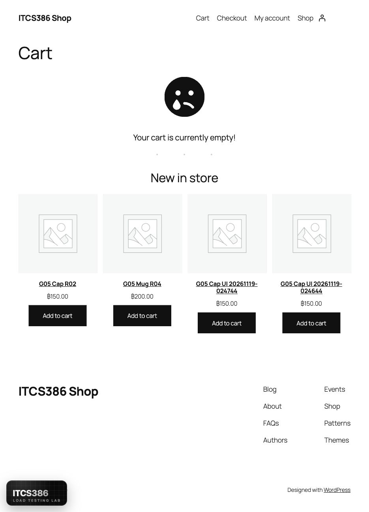

#### Step 6 — Pass

**Two caps re-added, one cart line**

#### Step 7 — Pass

**Completed Test 2 checkout inputs**

**Customer order confirmation**

#### Step 8 — Pass

**Staff verification of the 300 THB order**

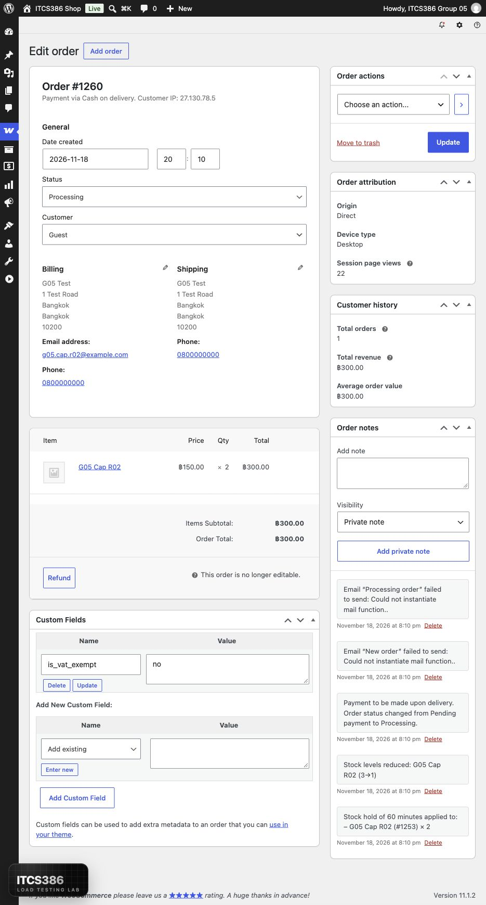

**Saved inventory after purchase: 1**

#### Step 9 — Pass

**Empty post-purchase cart**

**Product page at stock 1: no quantity field**

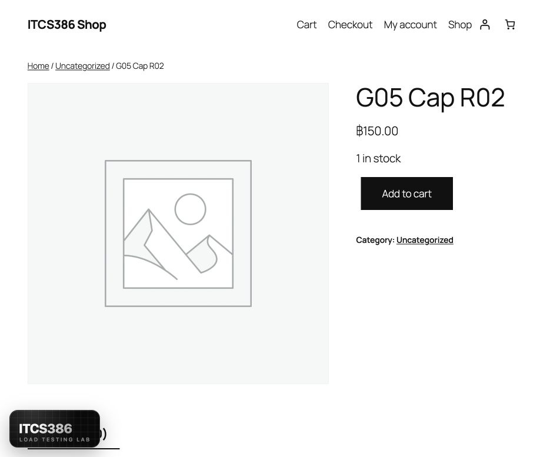

**Second Add to cart attempt rejected**

**Cart retains one unit with Increase quantity disabled**

## ST-G05-03

| Field | Details |
|---|---|
| Test case ID | ST-G05-03 |
| Title | Verify updated pricing and required-address validation for a guest purchase |
| Objective | Verify a saved regular-price change reaches the storefront, empty Street address blocks checkout, a corrected guest order uses the new price, and staff can complete it. |
| Preconditions | Staff logged in as itcs386-g05 for setup; new test name unused; logout before guest shopping; empty guest cart; Cash on delivery available. |
| Test data | `G05 Tee R02`, new product ID `1261`; price 225 THB after changing regular price from 250 THB; initial stock 10; purchase quantity 1; email `g05.tee.r02@example.com`. Order `1274`, 225 THB, recorded status Completed. |
| Date and time | 19 November 2026, 03:12–03:15 Asia/Bangkok |
| Recorded run | R02; 7/7 Pass |

[Open the execution report](ST-G05-03-R02-results.md).

| Step | Action | Input data | Expected result | Actual result | Pass or fail |
|---|---|---|---|---|---|
| 1 | Create and publish the tee at 250 THB, then change its regular price to 225 THB, Update and reload. | Product name = G05 Tee R02; Simple product; Regular price (฿) initially 250, then 225; Sale price blank; Stock management checked; Quantity = 10; Allow backorders? = Do not allow. | Published product retains the updated regular price of 225 THB after reopening. | Product 1261 was newly published at 250 THB; after Update and reload, regular price was 225. Blank form, pre-Publish inputs, initial publication and updated price captured. | Pass |
| 2 | Log out as staff and find/open the tee through the Shop list as guest. | Shop page 1; target G05 Tee R02; Next Page as needed; click the matching name. | Correct product appears at the updated price of 225 THB and is available to buy. | Found the tee on Shop page 15. Product page showed 225 THB and 10 in stock; no customer login or direct product URL used. | Pass |
| 3 | Add one tee and open checkout through the cart. | Product quantity = 1; Add to cart; View cart; Proceed to Checkout. | Cart and checkout show one unit at 225 THB. | Cart and guest checkout showed one tee at 225 THB with no coupon. | Pass |
| 4 | Fill the other required fields, verify Street address is empty, then attempt Place Order. | Email g05.tee.r02@example.com; First name G05; Last name Test; Thailand; Street address empty; Town / City Bangkok; State / County Bangkok; Postcode / ZIP 10200; Phone 0800000000; Cash on delivery. | Required-field validation is visible; no successful order confirmation appears and the form can be corrected. | The genuinely empty Street address produced Please enter a valid street address. The page remained at checkout; no successful confirmation appeared. | Pass |
| 5 | Correct Street address and place the valid order. | Street address = 1 Test Road; Tab; verify correction; other values unchanged; note unchecked; Place Order once. | Confirmation shows an order number and merchandise price 225 THB, not 250 THB; grand total matches displayed shipping/tax. | Order 1274 confirmed: one G05 Tee R02, COD, subtotal/total 225 THB, not the old 250 THB price. No separate shipping/tax charge. | Pass |
| 6 | Sign in as staff, find the order and compare with the confirmation. | Search orders: = 1274; open #1274 G05 Test; product 1261; email g05.tee.r02@example.com. | Staff order product, quantity, price, email and total match the guest confirmation. | Order was Guest with correct product, quantity 1, unit price/total 225 THB and email. Order notes recorded stock 10→9. | Pass |
| 7 | Set Completed, save and reload. | Order 1274; Status = Completed; Update; reload. | Completed persists after reopening; product details and totals remain unchanged. | Completed persisted after reload and the item/total remained 225 THB. | Pass |

### Checkout inputs used

| UI field / control | Value / action |
|---|---|
| Checkout mode | Guest, after staff logout |
| Email address | `g05.tee.r02@example.com` |
| First name | `G05` |
| Last name | `Test` |
| Country / Region | `Thailand` (verified selected) |
| Street address | Empty for step 4; explicitly verified before submission; corrected to `1 Test Road` in step 5 |
| + Add apartment, suite, unit, etc. | Left closed; second address line blank |
| Town / City | `Bangkok` |
| State / County | `Bangkok` selected from the dropdown |
| Postcode / ZIP | `10200` |
| Phone (optional) | `0800000000` |
| Payment | Cash on delivery selected |
| Add a note to your order | Unchecked |
| Separate shipping form / same-as-billing checkbox | Not displayed; no such input was made |
| Shipping method / Company field | Not displayed |
| Submission | One rejected empty-address attempt, followed by one successful corrected submission |
| Recorded total | 225.00 THB; no separate shipping/tax charge shown |

The form fields were filled for this run. No real customer account or real personal details were used. The staff order showed shipping details matching billing; that is an observed saved value, not evidence of a shipping checkbox.

### Run observations

Street address was verified empty before the validation attempt. The error was observed before correction; only the corrected request produced the successful order. No accidental order was created in this run. This case is guest checkout only and has seven steps; login and account-history checks are not included.

### Screenshots by step

#### Step 1 — Pass

**Add new product — blank form before entering data**

**Add new product — inventory entered, before Publish**

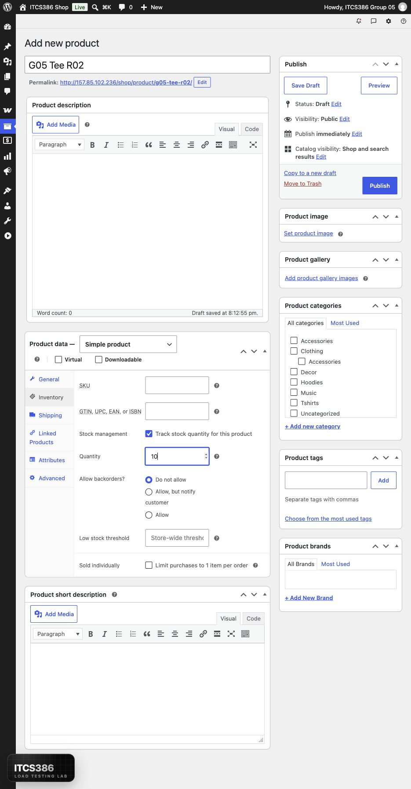

**Add new product — price entered, before Publish**

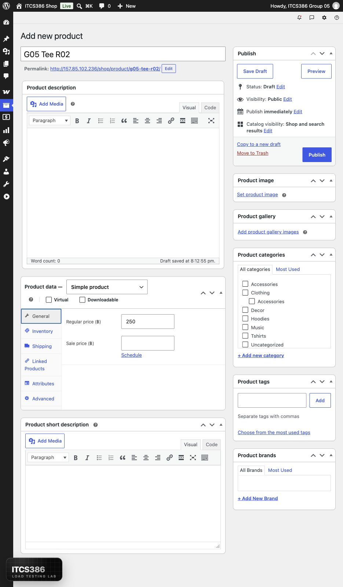

**New product published at the original 250 THB price**

**Regular price changed to 225 THB, saved and reloaded**

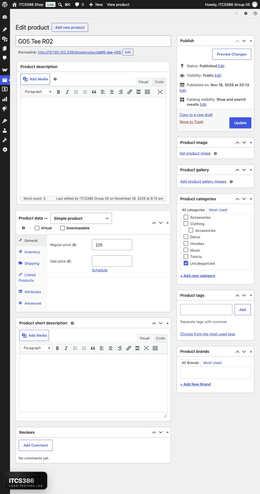

#### Step 2 — Pass

**Tee located in the Shop list**

**Tee detail shows the updated 225 THB price**

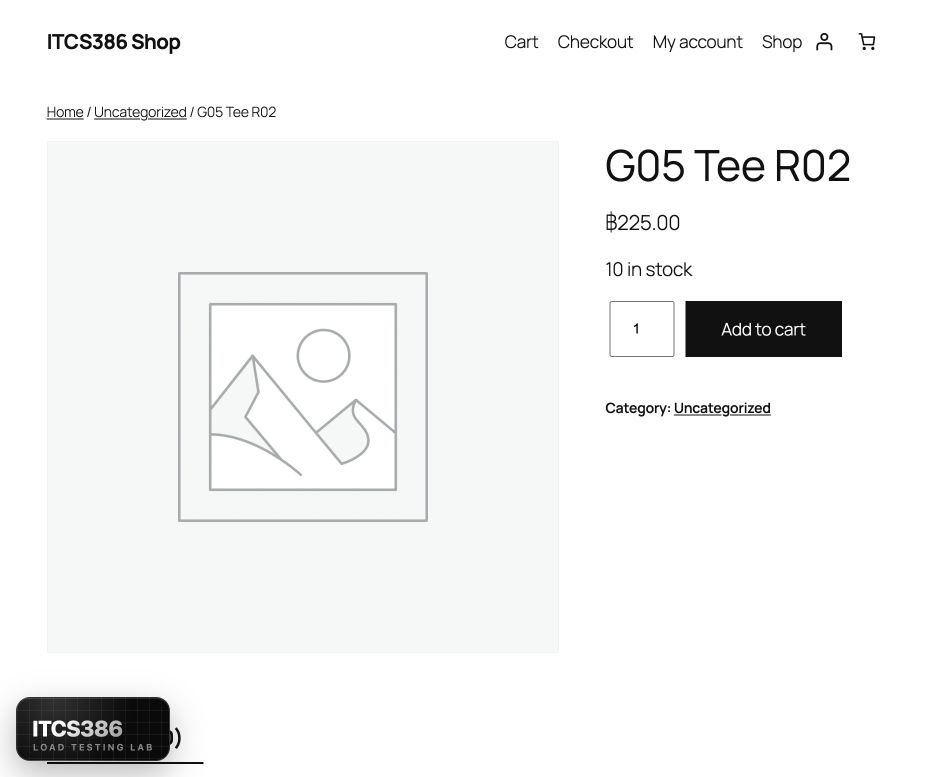

#### Step 3 — Pass

**One tee in the cart at 225 THB**

**Guest checkout at 225 THB**

#### Step 4 — Pass

**Street address verified empty before submission**

**Required-field validation prevents checkout**

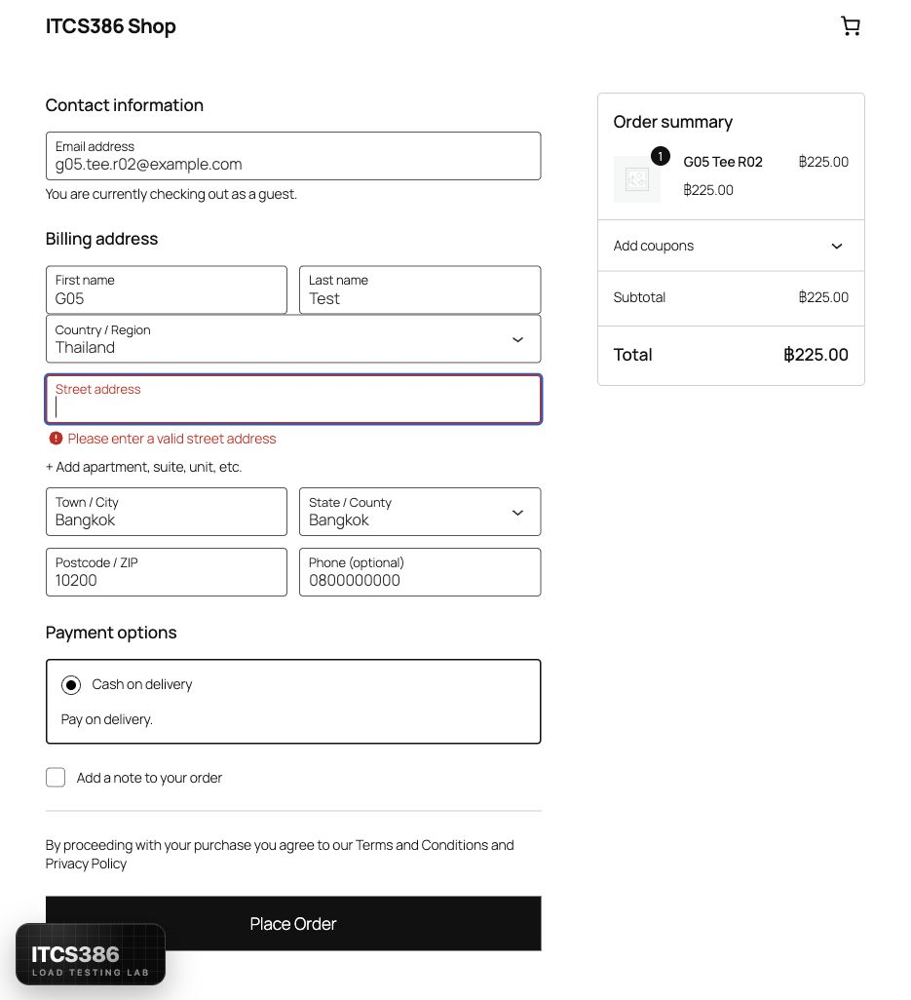

#### Step 5 — Pass

**Street address corrected to 1 Test Road**

**Corrected guest order confirmed at 225 THB**

#### Step 6 — Pass

**Staff order matches the guest purchase**

#### Step 7 — Pass

**Completed status persists after reload**

## Related documents

- [System-testing overview](README.md)
- [Tested-requirement traceability matrix](api-traceability-matrix.md)
- [API inventory](api-inventory.md) — reference only, not a claim to test every API.
