# System Test Cases — ITCS386 Group 5

**Revision 3.2 — locate products through the Shop list. Status: ST-G05-01 R02 passed all nine revised steps; ST-G05-02 R01 passed all nine steps; ST-G05-03 Not Run.** These three manual scenarios use the Project 2 template and cover staff → customer → staff outcomes. Step numbers restart at 1 in each case and match the [traceability matrix](api-traceability-matrix.md). ST-G05-01 contains recorded inputs/results; ST-G05-02 also contains recorded inputs/results; only ST-G05-03 execution fields remain blank.

## Shared execution setup

- Storefront: http://157.85.102.236/shop/
- Staff interface: http://157.85.102.236/shop/wp-admin/
- Staff account: `itcs386-g05`, verified against Group 5 in `ITCS386_Group_Accounts.xlsx`, sheet `ITCS386`, row 15. Use the browser login password in cell D15; never commit its value.
- Use separate staff/customer sessions. The dataset uses R02 for the recorded ST-G05-01 run and R01 for ST-G05-02 (executed) and ST-G05-03 (planned). Before a repeat run, replace this suffix consistently in every product name, coupon and case email with an unused value such as `R03` (continue to R04, R05, etc.; do not reuse a suffix from an earlier run). ST-G05-01 and ST-G05-02 values are recorded inputs; ST-G05-03 remains planned. Prefix names/codes with G05.
- Use only group-owned records; do not change demo data or other groups' records.
- Fictional checkout details: G05 Test, 1 Test Road, Bangkok, Bangkok province, 10200, Thailand, phone 0800000000. Use the case email; use the same fictional shipping address.
- Verify merchandise arithmetic separately from shipping/tax. Record the site's price/tax display basis and shipping charges before execution, then check the grand total against that breakdown. The 10% coupon calculation assumes the stated merchandise price is the discount basis.
- Save screenshots for every step under `screenshots/<case-ID>/<RUN_ID>/`; reference their paths and observed values in Actual result.
- Enter Pass or Fail only after running a step. Use Blocked if prerequisites prevent execution. Failed steps need a defect report with reproduction steps, expected/actual results and evidence.
- ST-G05-03 uses the designated fictional customer `g05.tee.r01@example.com`. Confirm this account exists and can log in before execution, or prepare it through the supported setup flow. Its password must be obtained from the tester's private credential store, not this document. No working account or password is claimed to have been created. If email verification blocks setup, record Blocked and obtain an instructor-approved test account; record any substituted test email consistently. Registration remains outside the tested scope.
- Latest ST-G05-01 run: R02, 17 November 2026, product 687, coupon 688, order 692 (Completed). All nine revised steps passed. ST-G05-02 R01 also passed on 17 November 2026 (product 773, order 774, 300 THB); ST-G05-03 remains Not Run.

## Group 5 account values

Verified source: `ITCS386_Group_Accounts.xlsx`, sheet `ITCS386`, row 15.

| Purpose | Group 5 value / source | Use in these tests |
|---|---|---|
| Shop staff username | `itcs386-g05` — B15 | Staff signs in to `http://157.85.102.236/shop/wp-admin/` before each case |
| Shop browser login password | Private value in D15, column Password (shop + hotel) | Enter locally for staff browser login; do not copy it into GitHub or evidence |
| Shop API password | Private value in F15, column Shop API password | Only for separate Admin REST API tests; not used for these manual browser logins |
| Hotel email | `itcs386-g05@itcs386.com` — C15 | Hotel login only; this is not a WooCommerce customer account supplied by the sheet |
| Hotel API key | Private value in E15 | Not used in the selected WooCommerce scenarios |

The sheet supplies the Group 5 **staff** account, not a separate shopper account. All staff actions below use that Group 5 account. The `G05` product/coupon prefixes and `g05.mug...`, `g05.cap...`, `g05.tee...` emails are fictional **Group 5 test data**, not credentials taken from the sheet. Keep the separate customer session so the tests exercise the shopper role.

For ST-G05-03, prepare or use a group-owned fictional customer account before execution; do not substitute the hotel email or Shop manager account for that customer. No working customer password is supplied by this document.

## Runtime values and expected amounts

- `ORDER_ST01`, `ORDER_ST02` and `ORDER_ST03` are the real order numbers to record after each successful checkout. Do not enter invented order numbers. Product IDs are also assigned by the server; select records by the exact names above.
- Passwords are the only intentionally private inputs. All other manually entered values are specified in the step tables.
- ST-G05-01: 200.00 × 2 = 400.00 THB; 10% discount = 40.00 THB; merchandise after discount = 360.00 THB.
- ST-G05-02: 150.00 × 1 = 150.00 THB; 150.00 × 2 = 300.00 THB; stock after purchase = 3 − 2 = 1.
- ST-G05-03: 225.00 × 1 = 225.00 THB; the old 250.00 THB price must not be charged.
- Grand totals use the actual displayed shipping and tax configuration. Do not assume these charges are zero or double-count tax already included in prices.
- Before execution, confirm that the run-specific invalid coupon (R02: `G05BAD-R02`) does not exist and that the run's product/coupon names are unused.

## Product discovery through the storefront

For all three cases, open `http://157.85.102.236/shop/`, look for the exact product name in the displayed product list, and use Next page when necessary. Click the matching product name to open its details. Do not use Search, a browser Find command, or a direct product URL. Record the page number where the product is found; it can change as other groups add products. Ordinary page navigation here is not a separate pagination, sorting or filtering test.

## Selected scope

The scenarios retain unusual inputs and actions: an invalid coupon and returning from checkout, an above-stock quantity and removing/re-adding an item, and a missing required address field followed by correction.

Category creation/browsing, permanent deletion, coupon removal, customer-list checks, catalog pagination/sorting/price filters and registration testing are outside this revision. No extra fixtures are required to exercise every API.

## ST-G05-01

**Recorded run: R02.** Actual input values and results below come from the 17 November execution. All nine revised steps passed, including locating the product in the Shop list on page 12. Do not reuse IDs 687/688/692 for a new creation run. Staff used the in-app browser; the guest used a separate Safari session. Order notes also showed New order, Processing order and Completed order email failures; mail delivery was not an assertion of this case.

| Field | Details |
|---|---|
| Test case ID | ST-G05-01 |
| Title | Purchase with a coupon and complete the order |
| Objective | Verify product/coupon setup, invalid coupon rejection, discounted purchase and staff order completion. |
| Preconditions | Staff is logged in as `itcs386-g05` using the private browser password from D15. Customer uses a separate session with an empty cart. COD is available. |
| Test data | Product: `G05 Mug R02` (ID `687`), simple, 200 THB, stock 20, backorders disabled. Coupon: `G05SAVE10-R02` (ID `688`), 10% discount restricted to this product. Invalid code: `G05BAD-R02`. Quantity 2. Email: `g05.mug.r02@example.com`. Captured order: `692` (COD, 360.00 THB). Product/order IDs are runtime outputs, not values to enter when creating records. |
| Tested by and date | Codex (browser-driven execution), 17 November 2026, approximately 17:19–17:25 Asia/Bangkok |

| Step | Action | Input data | Expected result | Actual result | Pass or fail |
|---|---|---|---|---|---|
| 1 | Staff creates and publishes the product and verifies its saved settings. | Name = G05 Mug R02; type = Simple product; regular price = 200.00 THB; sale price = empty; manage stock = enabled; stock = 20; backorders = Do not allow; status = Published | Product is published with the specified price and stock. | Published product 687 (G05 Mug R02), simple product, regular price 200.00 THB, stock 20, stock tracking enabled and backorders disabled. Saved settings verified. | Pass |
| 2 | Staff creates the product-restricted coupon. | Code = G05SAVE10-R02; discount type = Percentage discount; amount = 10; product restriction = G05 Mug R02 (#687); expiry = unset; minimum spend = 0; maximum spend = unset; usage limits = unset | Coupon is saved with the correct product restriction and discount. | Published coupon 688 (G05SAVE10-R02), percentage 10, minimum spend 0, restricted to product 687. Saved restriction verified. | Pass |
| 3 | Customer opens Shop, locates G05 Mug R02 in the product list (using Next page if needed), then clicks its name. | Start page = http://157.85.102.236/shop/; target product name = G05 Mug R02; navigation = Next page until found, then click G05 Mug R02 | Correct product appears at 200 THB and is available to buy. | Opened Shop page 1, followed Next Page through page 12, located G05 Mug R02 in the list and clicked its name. Product details showed 200.00 THB and stock 20. No storefront search or direct product URL was used. | Pass |
| 4 | Customer adds two units and opens the cart. | Product = G05 Mug R02 (#687); quantity = 2 | Cart contains two units with merchandise subtotal 400 THB. | Guest cart contained product 687, quantity 2, unit price 200.00 THB and subtotal 400.00 THB. | Pass |
| 5 | Customer tries the nonexistent coupon, then applies the valid coupon. | First code = G05BAD-R02; second code = G05SAVE10-R02 | Invalid code produces a visible error without changing the total. Valid code applies one 40 THB discount; discounted merchandise total is 360 THB. | G05BAD-R02 was rejected as nonexistent; total remained 400.00 THB. G05SAVE10-R02 applied one 40.00 THB discount; total became 360.00 THB. | Pass |
| 6 | Customer opens checkout and returns to the cart before ordering. | Open http://157.85.102.236/shop/checkout/; click Cart to return to http://157.85.102.236/shop/cart/; do not click Place Order | Product, quantity and coupon remain correct; no successful order confirmation appears. | Opened checkout and returned through Cart without ordering. Quantity 2, coupon and total 360.00 THB persisted. | Pass |
| 7 | Customer reopens checkout, enters fictional details and places one COD order. | Use every value/control in the Step 7 — Complete checkout inputs table below. Guest email = g05.mug.r02@example.com; billing = G05 Test, 1 Test Road, Bangkok, Bangkok, 10200, Thailand; phone = 0800000000; apartment = empty; COD selected; order note unchecked; no separate shipping form/method displayed; click Place Order once. | Confirmation shows an order number, two units, the 40 THB discount and the correct grand total. | Updated guest email to g05.mug.r02@example.com and expanded the retained billing address to verify all values. Placed one COD order, 692. Confirmation showed subtotal 400.00 THB, discount 40.00 THB and total 360.00 THB, without separate shipping/tax charges. | Pass |
| 8 | Staff locates and opens the order. | Staff order search = 692; product = G05 Mug R02 (#687); email = g05.mug.r02@example.com | Order details, coupon and total agree with the customer confirmation. | Staff search for 692 located the matching guest order. Product, quantity, coupon, email and totals matched the confirmation. Order notes recorded stock reduction from 20 to 18. | Pass |
| 9 | Staff changes the order to Completed, saves and reopens it. | Order ID = 692; original status = Processing; new status = Completed; click Update, then reload | Completed persists; order contents and totals are unchanged. | Changed order 692 from Processing to Completed, saved and reloaded. Completed persisted and total remained 360.00 THB. | Pass |

### Step 7 — Complete checkout inputs

See the [R02 execution report](ST-G05-01-R02-results.md) for the evidence filenames and complete results. Billing values were retained from the prior guest session, expanded and verified; the email was changed to R02.

Use the labels shown on the checkout page. These are the values used for the recorded R02 run, not real personal information.

| Section | Field / control shown in the UI | Value / action used |
|---|---|---|
| Contact information | Checkout mode | Guest; no customer login or account creation |
| Contact information | Email address | `g05.mug.r02@example.com` |
| Billing address | First name | `G05` |
| Billing address | Last name | `Test` |
| Billing address | Country / Region | `Thailand` |
| Billing address | Street address | `1 Test Road` |
| Billing address | + Add apartment, suite, unit, etc. | Left closed; no apartment/unit or second address line entered |
| Billing address | Town / City | `Bangkok` |
| Billing address | State / County | Select `Bangkok` from the dropdown; verify it is selected before submitting |
| Billing address | Postcode / ZIP | `10200` |
| Billing address | Phone (optional) | `0800000000` |
| Shipping | Separate shipping-address form / same-as-billing control | Neither was displayed in this run; no separate shipping values were entered. The saved staff order showed shipping details matching billing. |
| Shipping | Shipping method | No shipping-method selector was displayed; no method was manually selected |
| Payment options | Cash on delivery | Selected; API payment-method identifier is `cod` |
| Order note | Add a note to your order | Unchecked; note left empty |
| Checkout notice | Terms and Conditions / Privacy Policy notice | Informational text was displayed above Place Order; no separate acceptance checkbox was displayed or checked |
| Submission | Place Order | Click once after verifying the address, province, payment and order summary |

The recorded form exposed no Company field. Do not invent a value or add a field that is not displayed.

**Order summary to verify before submission**

| Displayed item | Recorded value |
|---|---|
| Product | `G05 Mug R02` |
| Unit price | 200.00 THB |
| Quantity | 2 |
| Subtotal | 400.00 THB |
| Applied coupon | `g05save10-r02` (displayed in lowercase by the site) |
| Discount | −40.00 THB |
| Total | 360.00 THB |
| Separate shipping/tax lines | Not displayed; no additional shipping/tax amount added to the displayed total |

**Confirmation after submission:** order `692`, email `g05.mug.r02@example.com`, payment `Cash on delivery`, product quantity `2`, total `360.00 THB`. Order 692 is an observed output, not an input to a new checkout.

## R02 screenshot evidence

### Step 1 — Pass

**Published mug and regular price**

**Saved stock quantity and backorder settings**

### Step 2 — Pass

**Published 10% coupon**

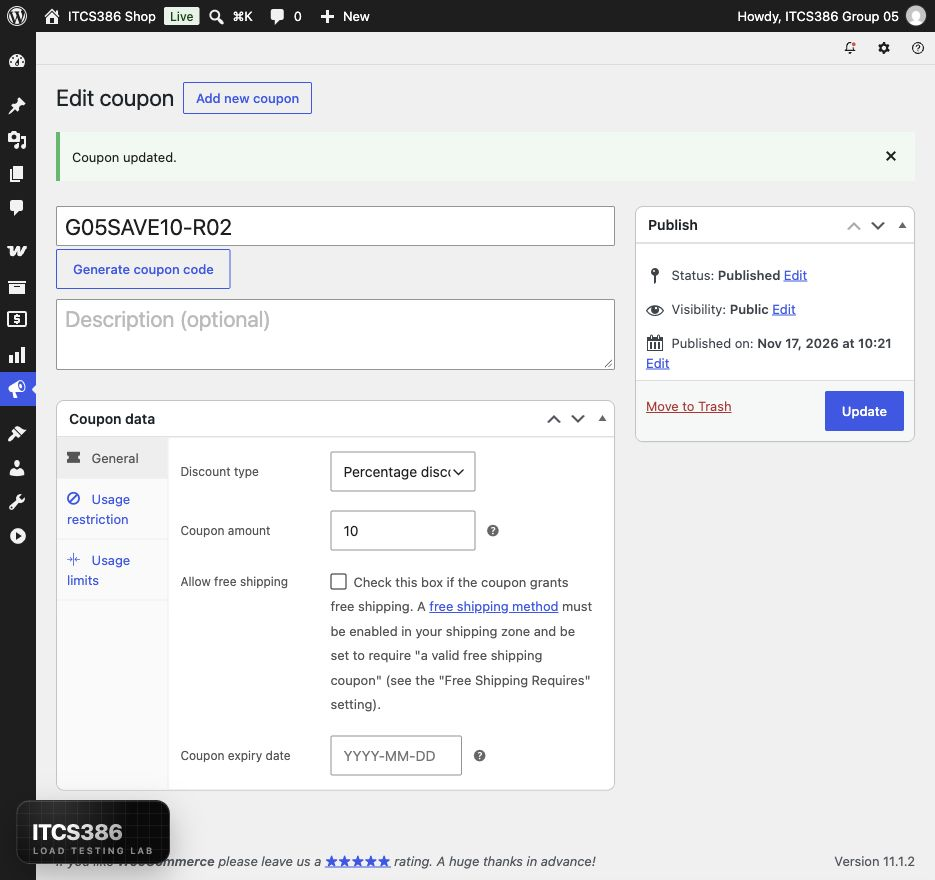

**Coupon restricted to G05 Mug R02**

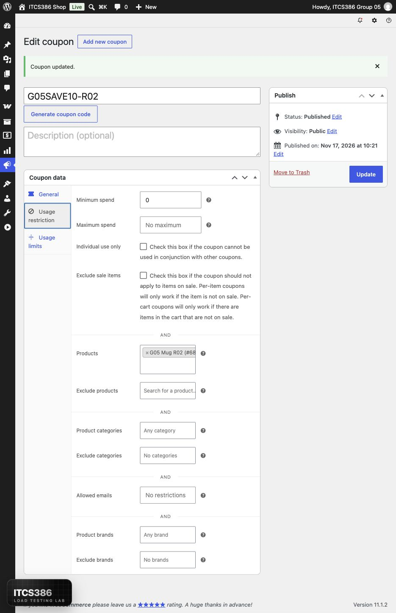

### Step 3 — Pass

**Shop list at the start of product discovery**

**G05 Mug R02 found in the Shop list on page 12**

**Product details opened from the list**

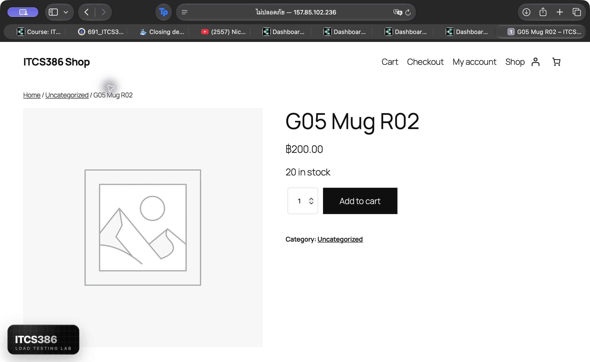

### Step 4 — Pass

**Two mugs and 400 THB subtotal**

### Step 5 — Pass

**Nonexistent coupon rejected**

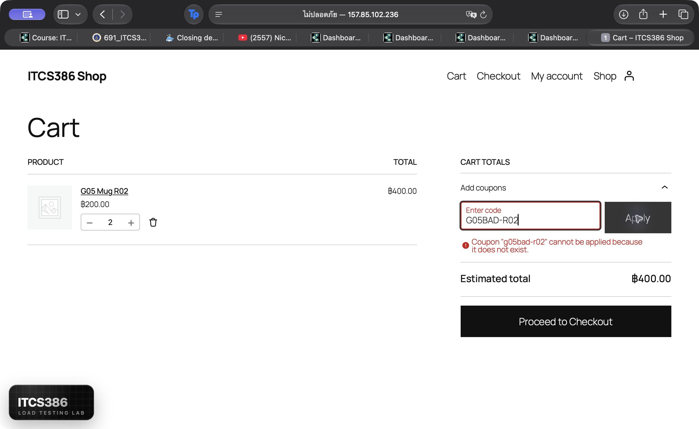

**Valid coupon applied; total 360 THB**

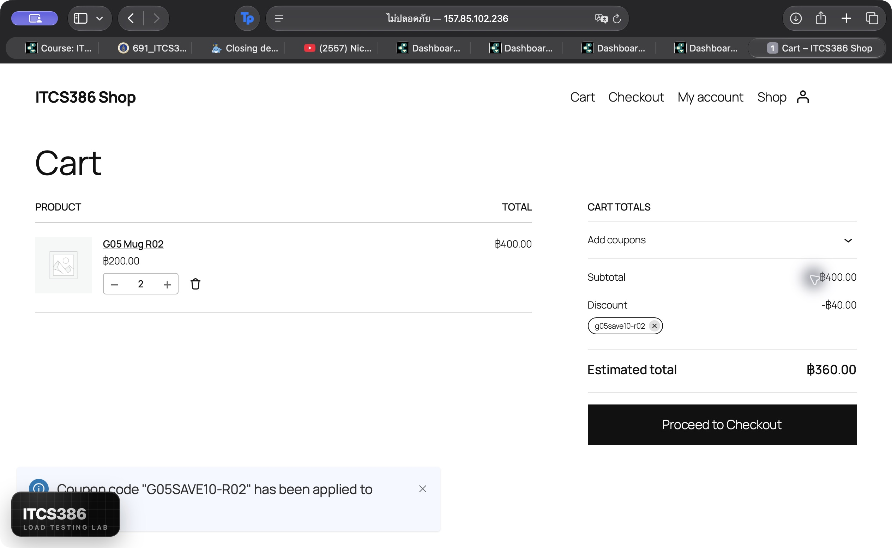

### Step 6 — Pass

**Checkout opened before returning**

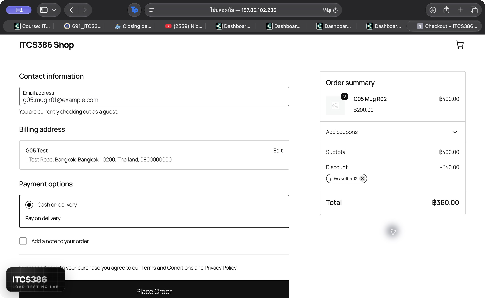

**Returned cart retains quantity and discount**

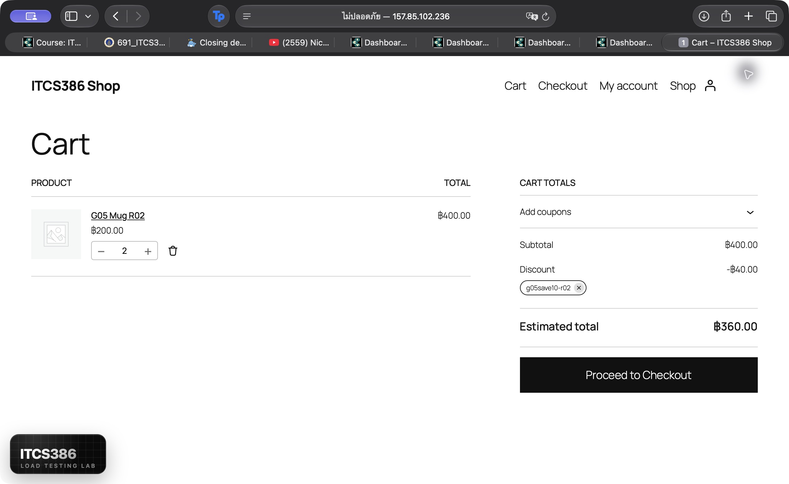

### Step 7 — Pass

**Guest checkout inputs**

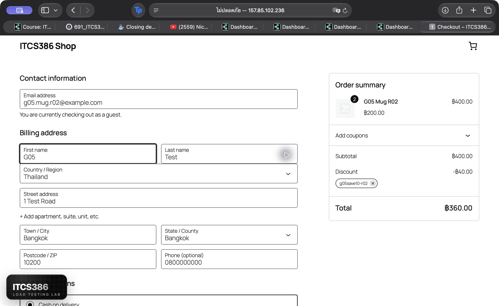

**Order 692 confirmation**

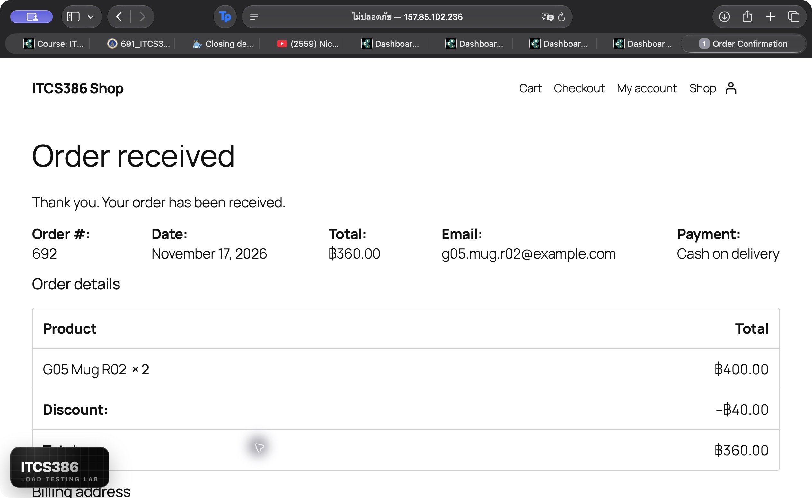

### Step 8 — Pass

**Staff order details match the customer confirmation**

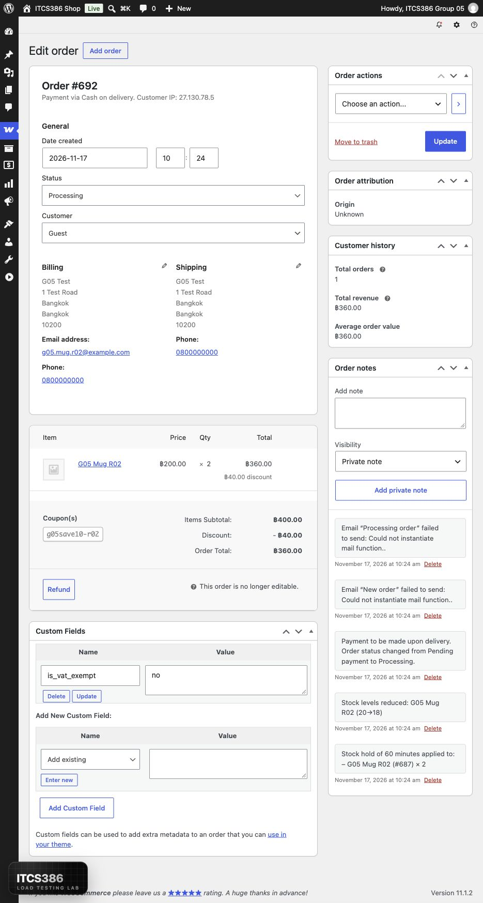

### Step 9 — Pass

**Completed status persists after reloading**

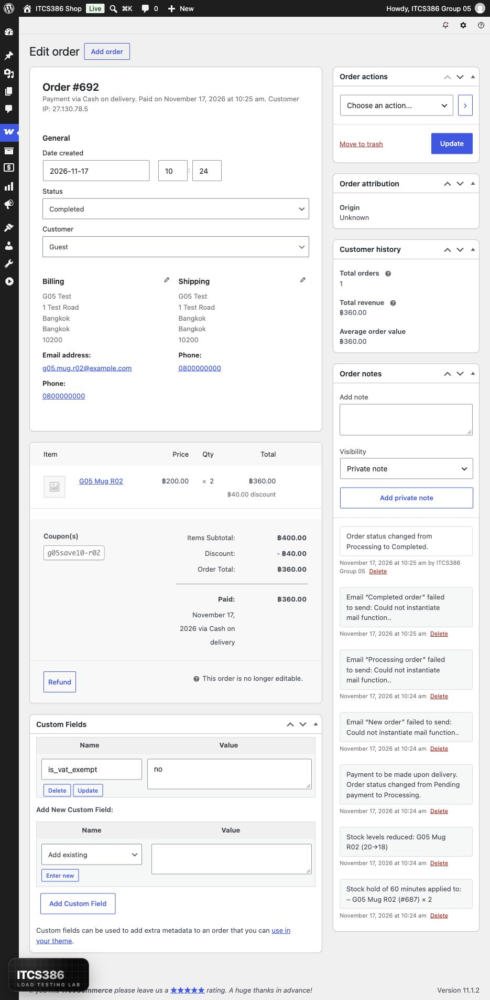

## ST-G05-02

**Recorded run: R01 — 9/9 Pass.** Executed by Codex through Computer Use/browser UI on 17 November 2026, 20:56–21:04 Asia/Bangkok. Staff used the in-app browser as `itcs386-g05`; the guest used a separate Safari session. Product ID: `773`; order ID: `774`, total `300.00 THB`, status `Processing`. See the [execution report](ST-G05-02-R01-results.md).

Input data below uses observed UI labels and the actual interaction performed. The original expected results are retained. Step 9 uses two Add to cart clicks because the product page hides quantity entry when only one unit remains; this preserves the original attempt-to-add-two objective without inventing an unavailable field.

| Field | Details |
|---|---|
| Test case ID | ST-G05-02 |
| Title | Validate quantity limits and remaining stock |
| Objective | Verify stock-limit validation, cart quantity changes/removal and stock reduction after a successful purchase. |
| Preconditions | Staff is logged in as `itcs386-g05` using the private browser password from D15. Customer uses a separate session with an empty cart. COD is available. |
| Test data | Product: `G05 Cap R01` (created ID `773`), simple, 150 THB, stock 3. Enable stock management; disable backorders and Sold individually. Quantities 1, 4 and 2. Email: `g05.cap.r01@example.com`. |
| Tested by and date | Codex, 17 November 2026, 20:56–21:04 Asia/Bangkok |

| Step | Action | Input data | Expected result | Actual result | Pass or fail |
|---|---|---|---|---|---|
| 1 | Staff creates and publishes the product, then reopens General and Inventory to verify the saved values. | Product name = G05 Cap R01; Product data = Simple product; Regular price (฿) = 150; Sale price (฿) = blank; Stock management = checked; Quantity = 3; Allow backorders? = Do not allow; Sold individually = unchecked; click Publish. Virtual and Downloadable remain unchecked. | Product is published at 150 THB with stock 3 and no backorders. | Created product 773. Saved simple-product price is 150 THB; Stock management checked, Quantity 3, Do not allow selected and Sold individually unchecked. | Pass |
| 2 | Customer opens Shop, follows Next Page until G05 Cap R01 is visible, clicks its name, leaves Product quantity at 1 and clicks Add to cart, then View cart. | Start = http://157.85.102.236/shop/; product-list target = G05 Cap R01; Next Page through page 13 in this run; Product quantity = 1; Add to cart; View cart. No search field or direct product URL. | Correct product appears at 150 THB; cart contains one unit with merchandise subtotal 150 THB. | Found G05 Cap R01 in the Shop list on page 13 (249 catalog results), opened it and observed 150 THB / 3 in stock. Added one unit; cart subtotal was 150 THB. | Pass |
| 3 | Customer selects the cart quantity value, enters 4 and presses Tab to leave the field. | Field accessibility label = Quantity of G05 Cap R01 in your cart.; replace 1 with attempted value 4; press Tab. Available stock before this attempt = 3. | The excessive quantity is prevented or rejected with visible feedback; cart does not retain more than stock 3. | After attempted input 4 and Tab, the quantity was capped at 3, Increase quantity was disabled and the total became 450 THB. No error banner appeared; the control/value change was the visible feedback. | Pass |
| 4 | Customer selects the cart quantity value, enters 2 and presses Tab. | Field = Quantity of G05 Cap R01 in your cart.; enter 2; press Tab. No separate Update cart button was used. | Cart updates to two units and merchandise subtotal 300 THB. | Quantity updated to 2 and the cart total became 300 THB. | Pass |
| 5 | Customer clicks the trash/remove control for G05 Cap R01. | Trash icon; accessibility label = Remove G05 Cap R01 from cart. | Cart becomes empty with no remaining merchandise charge for the product. | The page displayed Your cart is currently empty! and the test product was removed. | Pass |
| 6 | Customer uses browser Back to return to the product, sets Product quantity to 2, clicks Add to cart and then View cart. | Product quantity = 2 on G05 Cap R01; click Add to cart, then View cart. | Cart contains exactly two units with merchandise subtotal 300 THB and no duplicate line. | Re-added exactly two units; one cart line showed quantity 2 and total 300 THB, with no duplicate line or retained coupon. | Pass |
| 7 | Customer clicks Proceed to Checkout, changes the Email address, expands Edit billing address to verify the retained fields, and clicks Place Order once. | Email address = g05.cap.r01@example.com; click Edit billing address; First name = G05; Last name = Test; Country / Region = Thailand; Street address = 1 Test Road; Town / City = Bangkok; State / County = Bangkok; Postcode / ZIP = 10200; Phone (optional) = 0800000000. Verify retained billing values; leave + Add apartment, suite, unit, etc. closed; Cash on delivery selected; Add a note to your order unchecked; click Place Order once. No separate shipping-address checkbox or shipping-method selector was displayed. | Confirmation shows an order number, two units and merchandise total 300 THB; grand total matches displayed shipping/tax. | Created order 774 as a guest using Cash on delivery. Confirmation showed G05 Cap R01 × 2, email g05.cap.r01@example.com and total 300 THB. No separate shipping/tax charge appeared. | Pass |
| 8 | Staff searches Orders for the captured order number, opens the order, then opens the product and its Inventory tab. | Search orders: = 774; open #774 G05 Test; product = G05 Cap R01 (ID 773); open Inventory and read Quantity. Order/product IDs were captured during execution, not supplied when creating records. | Order quantity is two and remaining stock is one. Earlier cart changes did not cause extra permanent stock deductions. | Order 774 matched the customer confirmation and had status Processing. Order notes recorded stock 3→1; the saved product Inventory Quantity was 1. Earlier cart changes caused no extra permanent stock deduction. | Pass |
| 9 | Customer confirms the post-purchase cart is empty, reopens the product through the Shop list and attempts a total of two units by clicking Add to cart twice. Open View cart after the rejection. | Start with empty cart; product page shows 1 in stock and no Product quantity field. Click Add to cart once to add 1, then click it again to attempt a total of 2; click View cart. Do not enter 2 into a nonexistent field. | The system prevents adding more than the one unit remaining. | With one unit remaining, the product page exposed only Add to cart, not a quantity field. First click added one. Second click was rejected: You cannot add that amount to the cart — we have 1 in stock and you already have 1 in your cart. Cart retained quantity 1, total 150 THB and a disabled Increase quantity control. | Pass |

### Test 2 checkout — observed fields and values

| UI label / control | Value or action in this run |
|---|---|
| Checkout mode | Guest |
| Email address | Replaced the retained email with `g05.cap.r01@example.com` |
| Edit billing address | Expanded to inspect the retained address |
| First name | `G05` |
| Last name | `Test` |
| Country / Region | `Thailand` |
| Street address | `1 Test Road` |
| + Add apartment, suite, unit, etc. | Left closed; second address line empty |
| Town / City | `Bangkok` |
| State / County | `Bangkok` |
| Postcode / ZIP | `10200` |
| Phone (optional) | `0800000000` |
| Cash on delivery | Selected |
| Add a note to your order | Unchecked; note empty |
| Separate shipping form / same-as-billing checkbox | Not displayed; no such checkbox was clicked |
| Shipping method | No selector displayed; no manual shipping-method input |
| Place Order | Clicked once |
| Product / quantity | `G05 Cap R01` / `2` |
| Subtotal / total | `300.00 THB` / `300.00 THB`; no coupon or separate shipping/tax charge displayed |

The billing values were retained by the guest session and verified after expanding the form; they were not all typed again. The staff order displayed shipping details matching billing. This is an observed result, not evidence of a same-as-billing input control.

### Test 2 observations and cleanup

- Step 3 passed through visible quantity limiting (4 was capped at 3), not an error message.
- Step 9 passed through rejection of the second Add to cart request; the quantity field was absent at stock 1.
- New order and Processing order email notifications failed with “Could not instantiate mail function”. Email delivery was not an assertion of this case.
- After step 9 evidence was captured, the one unpurchased cap was removed and the cart was verified empty. No second order was placed.
- Product 773 remains with stock 1. Order 774 remains Processing; changing it to Completed is not part of Test 2.
- All screenshots are unaltered. Browser chrome and staff requester IP may be visible. No password is included.

### Test 2 — screenshots by step

#### Step 1 — Pass

Created product 773. Saved simple-product price is 150 THB; Stock management checked, Quantity 3, Do not allow selected and Sold individually unchecked.

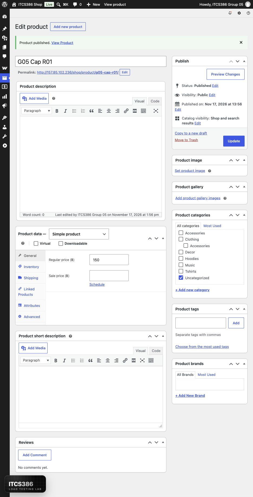

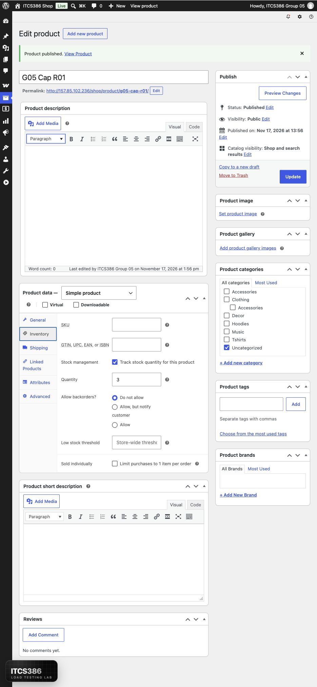

#### Step 2 — Pass

Found G05 Cap R01 in the Shop list on page 13 (249 catalog results), opened it and observed 150 THB / 3 in stock. Added one unit; cart subtotal was 150 THB.

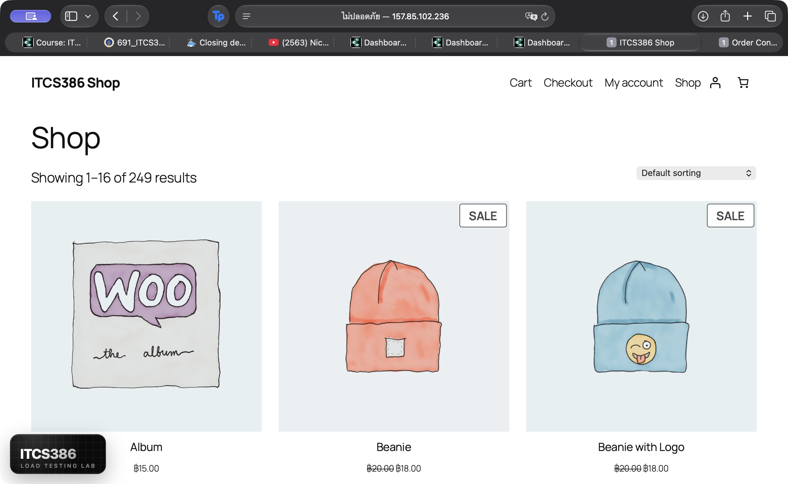

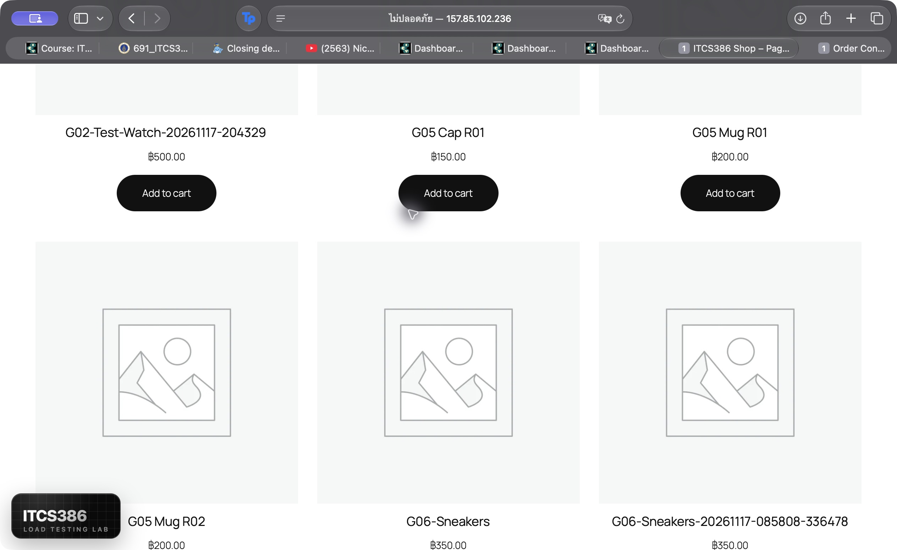

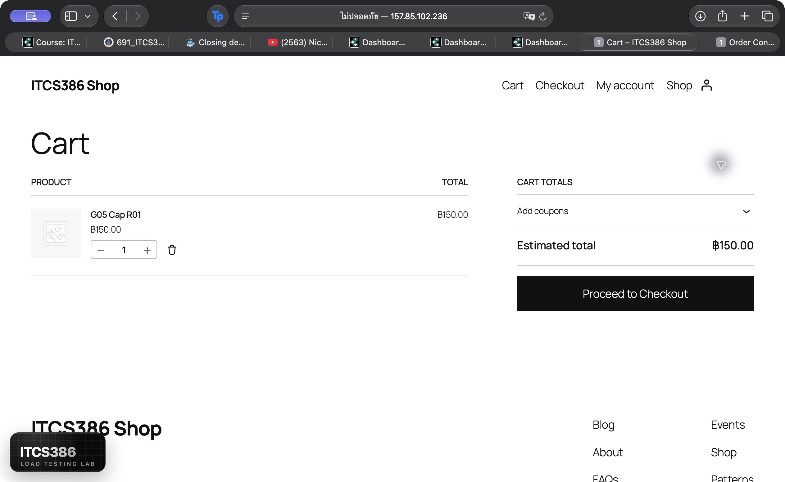

#### Step 3 — Pass

After attempted input 4 and Tab, the quantity was capped at 3, Increase quantity was disabled and the total became 450 THB. No error banner appeared; the control/value change was the visible feedback.

#### Step 4 — Pass

Quantity updated to 2 and the cart total became 300 THB.

#### Step 5 — Pass

The page displayed Your cart is currently empty! and the test product was removed.

#### Step 6 — Pass

Re-added exactly two units; one cart line showed quantity 2 and total 300 THB, with no duplicate line or retained coupon.

#### Step 7 — Pass

Created order 774 as a guest using Cash on delivery. Confirmation showed G05 Cap R01 × 2, email g05.cap.r01@example.com and total 300 THB. No separate shipping/tax charge appeared.

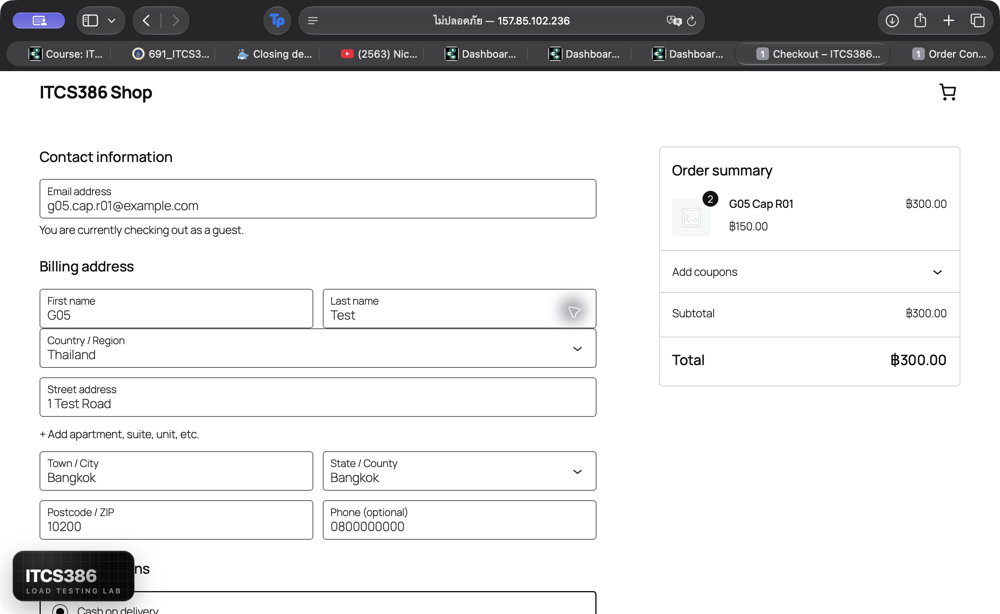

#### Step 8 — Pass

Order 774 matched the customer confirmation and had status Processing. Order notes recorded stock 3→1; the saved product Inventory Quantity was 1. Earlier cart changes caused no extra permanent stock deduction.

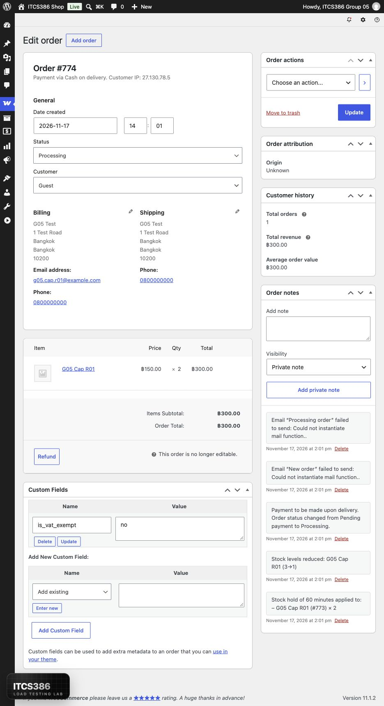

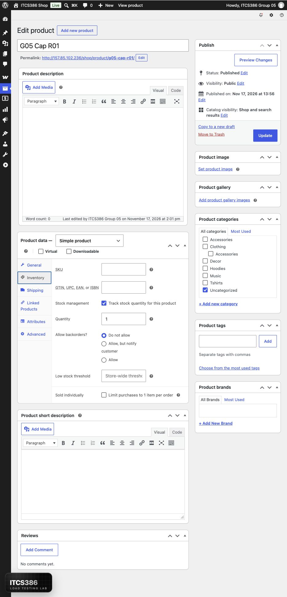

#### Step 9 — Pass

With one unit remaining, the product page exposed only Add to cart, not a quantity field. First click added one. Second click was rejected: You cannot add that amount to the cart — we have 1 in stock and you already have 1 in your cart. Cart retained quantity 1, total 150 THB and a disabled Increase quantity control.

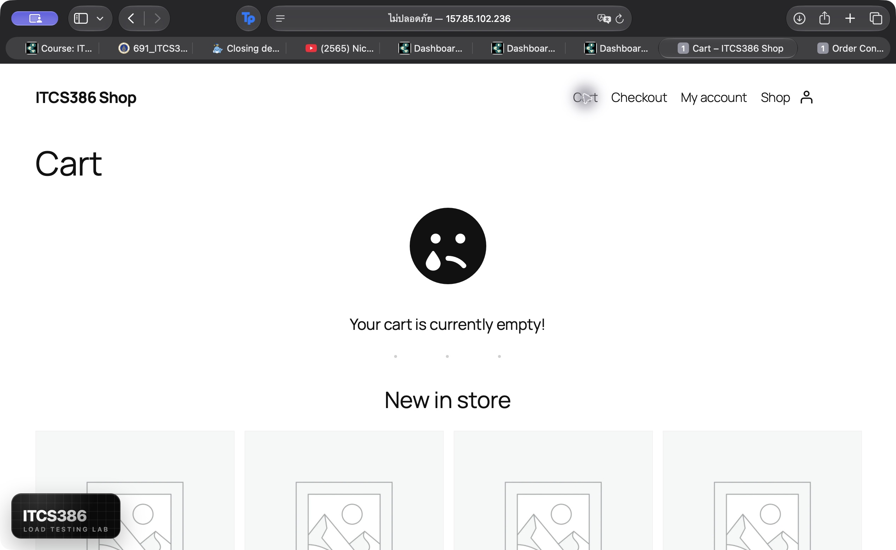

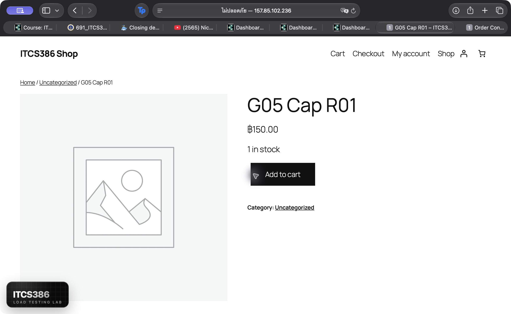

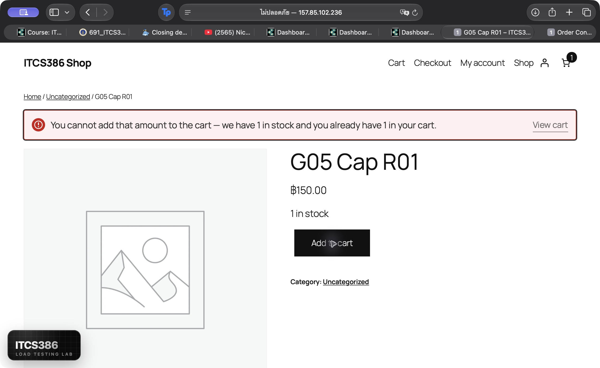

## ST-G05-03

| Field | Details |
|---|---|
| Test case ID | ST-G05-03 |
| Title | Verify updated pricing and customer order history |
| Objective | Verify that a staff price update is used for a logged-in purchase and that the completed order appears correctly in customer history. |
| Preconditions | Staff is logged in as `itcs386-g05` using the private browser password from D15. A group-owned fictional customer account already exists and can log in. Account creation is setup, not a tested requirement. Customer cart is empty; COD is available. |
| Test data | Product: `G05 Tee R01`, simple, initial price 250 THB, new price 225 THB, stock 10, backorders disabled. Quantity 1. Login email: `g05.tee.r01@example.com`; obtain the actual password from the private test credential store. Invalid input: leave Address line 1 empty. |
| Tested by and date | |

| Step | Action | Input data | Expected result | Actual result | Pass or fail |
|---|---|---|---|---|---|
| 1 | Staff creates a new group-owned product, changes its price and saves it. | Name = G05 Tee R01; type = Simple product; initial regular price = 250.00 THB; updated regular price = 225.00 THB; sale price = empty; manage stock = enabled; stock = 10; backorders = Do not allow; status = Published | Published product retains the updated regular price of 225 THB after reopening. | | |
| 2 | Customer logs in, opens Shop, locates G05 Tee R01 in the product list (using Next page if needed), then clicks its name. | Login email = g05.tee.r01@example.com; password = actual password from private test credential store; start page = http://157.85.102.236/shop/; target product = G05 Tee R01; Next page until found, then click its name | Correct account is active and the product displays the new price 225 THB. | | |
| 3 | Customer adds one unit and opens checkout. | Product = G05 Tee R01; quantity = 1 | Cart/checkout shows one unit at 225 THB and retains the authenticated session. | | |
| 4 | Customer fills other required fields but leaves Address line 1 blank and attempts to order. | First name = G05; last name = Test; address line 1 = empty (clear any saved/autofilled value); address line 2 = empty; city = Bangkok; province = Bangkok; postcode = 10200; country = Thailand; phone = 0800000000; email = g05.tee.r01@example.com; shipping address = same as billing; payment = Cash on delivery (cod) | Required-field validation is visible; no successful order confirmation appears and the form can be corrected. | | |
| 5 | Customer corrects the address and places one COD order. | First name = G05; last name = Test; address line 1 = 1 Test Road; address line 2 = empty; city = Bangkok; province = Bangkok; postcode = 10200; country = Thailand; phone = 0800000000; email = g05.tee.r01@example.com; shipping address = same as billing; payment = Cash on delivery (cod) | Confirmation shows an order number and merchandise price 225 THB, not 250 THB; grand total matches displayed shipping/tax. | | |
| 6 | Customer opens My account → Orders and views the order. | Open My account > Orders; select ORDER_ST03 captured in step 5 | The customer's order appears with the correct product, quantity and totals. | | |
| 7 | Staff opens the same order and verifies the customer and purchase details. | Order = ORDER_ST03; customer email = g05.tee.r01@example.com; product = G05 Tee R01; quantity = 1 | Order is associated with the logged-in test customer and agrees with the customer confirmation. | | |
| 8 | Staff changes the order to Completed and saves it. | Order = ORDER_ST03; new status = Completed | Completed is saved successfully. | | |
| 9 | Customer refreshes order history and reopens the order. | Account = g05.tee.r01@example.com; order = ORDER_ST03; refresh My account > Orders and reopen the order | Order status is Completed; product details and totals remain unchanged. | | |

## Related documents

- [Requirement traceability matrix and API appendix](api-traceability-matrix.md)
- [API inventory](api-inventory.md): a reference list, not a requirement to test every endpoint.

These are UI system tests. Related API behavior does not prove that a particular endpoint was called. Performance/load tests must not place orders or bookings.
